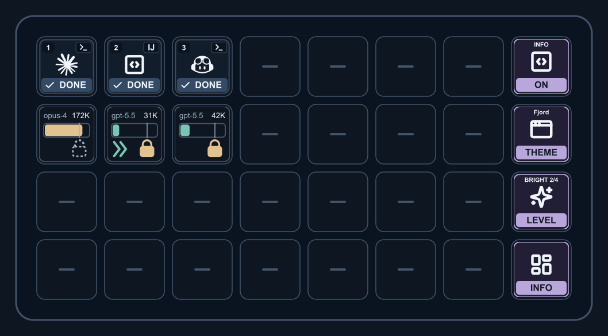
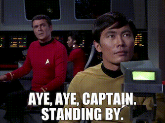
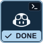
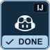
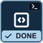
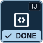
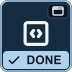
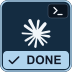
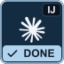
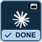

# AI AI Captain

New users: start with [Quick Start](#quick-start), or the [User Guide](USER_GUIDE.md). It has the build, install, run, and configure steps.

<table border="0">
<tr>
<td>

</td>
<td valign="top">



</td>
</tr>
</table>

AI AI Captain shows the status of your AI assistant sessions on a Stream Deck XL and in a web dashboard. It runs locally. It does not keep prompts or conversation content.

<table>
<tr>
<td align="center" valign="top"><br><b>GitHub Copilot</b><br>CLI</td>
<td align="center" valign="top"><br><b>GitHub Copilot</b><br>IntelliJ IDEA</td>
<td align="center" valign="top"><br><b>Codex</b><br>CLI</td>
<td align="center" valign="top"><br><b>Codex</b><br>IntelliJ IDEA</td>
<td align="center" valign="top"><br><b>Codex</b><br>ChatGPT desktop app</td>
</tr>
<tr>
<td align="center" valign="top"><br><b>Claude Code</b><br>CLI</td>
<td align="center" valign="top"><br><b>Claude Code</b><br>IntelliJ IDEA</td>
<td align="center" valign="top"><br><b>Claude Code<br>chats</b><br>Claude desktop app</td>
<td align="center" valign="top"><br><b>Junie</b><br>IntelliJ IDEA</td>
<td align="center" valign="top"><br><b>Other harnesses</b><br>CLI reporter or HTTP API</td>
</tr>
</table>

## Documentation

 Document                                         | Content                                                  |
 ------------------------------------------------ | -------------------------------------------------------- |
 [USER_GUIDE.md](USER_GUIDE.md)                   | Build, install, run, configure, and troubleshoot         |
 [architecture.md](architecture.md)               | Component boundaries, technology, privacy constraints    |
 [functionality.md](functionality.md)             | Session behavior, lifecycle states, acceptance scenarios |
 [design.md](design.md)                           | Visual language, state wording, palettes                 |
 [intagration.md](intagration.md)                 | Supported tools, API, hooks, configuration               |
 [docs/design/README.md](docs/design/README.md)   | Palette gallery and design artifact regeneration         |
 [integrations/README.md](integrations/README.md) | Reporters for other harnesses                            |
 [streamdeck/README.md](streamdeck/README.md)     | Stream Deck plugin, layout, key states                   |

## Quick start

Install the Stream Deck plugin:

1. Install Node.js 24 or higher and the Elgato Stream Deck app. Open the app.
2. Install the Elgato CLI:

   ```sh
   npm install -g @elgato/cli
   ```

3. Build the project and install the plugin:

   ```sh
   npm install
   npm run reload:streamdeck
   ```

4. In the Stream Deck app, select the profile **AI AI Captain XL**.

Do not move the project folder after you install the plugin. Refer to [USER_GUIDE.md](USER_GUIDE.md) for details.

## Run locally

Use this script to debug the hub and the dashboard:

```sh
npm install
npm run dev
```

Open <http://127.0.0.1:43681>.

## Report a session

```sh
npm run report -- upsert --source codex --harness codex-cli --state working --label "Refactor auth" --project "$PWD" --app "IntelliJ IDEA"
npm run report -- end --id SESSION_ID --state done
```

## Session API

- `GET /api/sessions` returns the current snapshot, detected apps, and settings.
- `GET /api/settings` and `PUT /api/settings` read and save the icon palette.
- `GET /api/clients` lists detected apps without session tracking.
- `POST /api/clients/:id/focus` focuses a detected app.
- `PUT /api/sessions/:id` creates or updates a session.
- `POST /api/sessions/:id/end` ends a session.
- `POST /api/sessions/:id/focus` focuses the session target.
- `DELETE /api/sessions/:id` removes a session.
- `GET /api/dashboard/browser` and `POST /api/dashboard/open` reuse or open the dashboard tab.
- `GET /api/events` streams changes as SSE.
- `GET /health` is a process health check.

The hub binds to `127.0.0.1` by default. Do not put prompts or transcripts in `label`, `project`, or `metadata`.

## Development

```sh
npm test
npm run typecheck
npm run build
npm run build:sea
```

GitHub Actions runs typecheck, tests, and build on pull requests and on `main`. Release Please reads Conventional Commits on `main` and opens a release pull request. Refer to [AGENTS.md](AGENTS.md) for the commit rules.

Release Please needs the repository setting **Allow GitHub Actions to create and approve pull requests**. Set the optional `RELEASE_PLEASE_TOKEN` secret to run CI on release pull requests.
