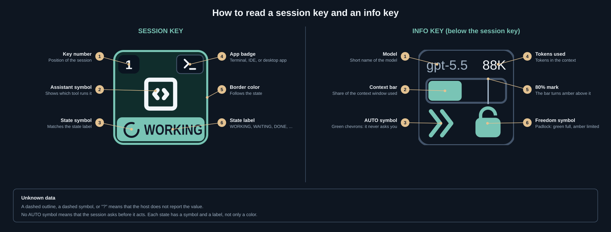

# AI AI Captain

New users: start with [Quick Start](#quick-start), or the [User Guide](USER_GUIDE.md). It has the build, install, run, and configure steps.

<table border="0">
<tr>
<td>

</td>
<td valign="top">


</td>
</tr>
</table>

AI AI Captain shows the status of your AI assistant sessions on a Stream Deck XL and in a web dashboard. It runs locally. It does not keep prompts or conversation content.

<table>
<tr>
<td align="center" valign="top"><br><b>GitHub Copilot</b><br>CLI</td>
<td align="center" valign="top"><br><b>GitHub Copilot</b><br>IntelliJ IDEA</td>
<td align="center" valign="top"><br><b>Codex</b><br>CLI</td>
<td align="center" valign="top"><br><b>Codex</b><br>IntelliJ IDEA</td>
<td align="center" valign="top"><br><b>Codex</b><br>ChatGPT desktop app</td>
</tr>
<tr>
<td align="center" valign="top"><br><b>Claude Code</b><br>CLI</td>
<td align="center" valign="top"><br><b>Claude Code</b><br>IntelliJ IDEA</td>
<td align="center" valign="top"><br><b>Claude Code<br>chats</b><br>Claude desktop app</td>
<td align="center" valign="top"><br><b>Junie</b><br>IntelliJ IDEA</td>
<td align="center" valign="top"><br><b>Other harnesses</b><br>CLI reporter or HTTP API</td>
</tr>
</table>




### Features by host

The theme, brightness, and info key toggle settings apply to the whole hub. They do not depend on the host. Each host supplies its own info key data.

 Host            | Session key | Info key data                                    | Theme | Brightness | Info key toggle |
 --------------- | ----------- | ------------------------------------------------ | ----- | ---------- | --------------- |
 GitHub Copilot  | Yes         | Not read. Report it with the reporter or the API | Yes   | Yes        | Yes             |
 Codex           | Yes         | Model, tokens, context, freedom, and approval    | Yes   | Yes        | Yes             |
 Claude Code     | Yes         | Model, tokens, and context                       | Yes   | Yes        | Yes             |
 Junie           | Yes         | Model, tokens, context, freedom, and approval    | Yes   | Yes        | Yes             |
 Other harnesses | Yes         | Reporter or API fields                           | Yes   | Yes        | Yes             |

Change the settings in the dashboard. On a physical Stream Deck, you can also use the **Toggle Info Keys**, **Cycle Theme**, and **Cycle Brightness** keys. Refer to [streamdeck/README.md](streamdeck/README.md).

## Documentation

| Document                                         | Content                                                  |
| ------------------------------------------------ | -------------------------------------------------------- |
| [USER_GUIDE.md](USER_GUIDE.md)                   | Build, install, run, configure, and troubleshoot         |
| [architecture.md](architecture.md)               | Component boundaries, technology, privacy constraints    |
| [functionality.md](functionality.md)             | Session behavior, lifecycle states, acceptance scenarios |
| [design.md](design.md)                           | Visual language, state wording, palettes                 |
| [intagration.md](intagration.md)                 | Supported tools, API, hooks, configuration               |
| [docs/design/README.md](docs/design/README.md)   | Palette gallery and design artifact regeneration         |
| [integrations/README.md](integrations/README.md) | Reporters for other harnesses                            |
| [streamdeck/README.md](streamdeck/README.md)     | Stream Deck plugin, layout, key states                   |

## Quick start

Install the Stream Deck plugin:

1. Install Node.js 24 or higher and the Elgato Stream Deck app. Open the app.
2. Install the Elgato CLI:

   ```sh
   npm install -g @elgato/cli
   ```

3. Build the project and install the plugin:

   ```sh
   npm install
   npm run reload:streamdeck
   ```

4. In the Stream Deck app, select the profile **AI AI Captain XL**.

Do not move the project folder after you install the plugin. Refer to [USER_GUIDE.md](USER_GUIDE.md) for details.

## Run locally

Use this script to debug the hub and the dashboard:

```sh
npm install
npm run dev
```

Open <http://127.0.0.1:43681>.

## Virtual deck (no Stream Deck)

Open <http://127.0.0.1:43681/deck.html>, or use the "Open deck only" link on the dashboard, to see a virtual Stream Deck XL. Install it as a standalone app from the browser. Refer to [USER_GUIDE.md](USER_GUIDE.md) section 6.2.

In a browser that supports Document Picture-in-Picture, click **Keep on top** to open an always-on-top deck window. Keep the original page open. Click **Return to deck**, or close the floating window, to return the deck to the original page.

To start the hub without the Stream Deck and open the deck in a small Chrome or Chromium app window, run this command:

```sh
npm run deck:app
```

The command detects macOS or Linux. On macOS, it opens Google Chrome through the system app launcher. On Linux, it looks for `google-chrome`, `google-chrome-stable`, `chromium`, or `chromium-browser` on `PATH`. It reports an error if it cannot find a supported browser or operating system.

The startup check connects directly to the local hub. It ignores curl configuration and proxy settings. Each request has a one-second limit.

Push Ctrl+C to stop the hub. Set `AI_AI_CAPTAIN_DECK_WINDOW_SIZE` (default `420,140`) to change the window size. The hub uses port 43682, so it does not conflict with the Stream Deck hub. Set `AI_AI_CAPTAIN_DECK_PORT` to change the port.

## Demo all keys

```sh
npm run demo:keys
```

The command shows 24 demo keys and cycles their states. Push Ctrl+C to remove every demo key, including leftover keys from a previous demo. Use `npm run demo:keys -- --brightness` to compare WAITING and DONE flash intensity 0 through 4. Higher levels make bright phases brighter and dim phases darker. Refer to [USER_GUIDE.md](USER_GUIDE.md) section 7.7.

## Report a session

```sh
npm run report -- upsert --source codex --harness codex-cli --state working --label "Refactor auth" --project "$PWD" --app "IntelliJ IDEA"
npm run report -- end --id SESSION_ID --state done
```

## Session API

- `GET /api/sessions` returns the current snapshot, detected apps, and settings.
- `GET /api/settings` and `PUT /api/settings` read and save the icon palette and flash intensity.
- `GET /api/clients` lists detected apps without session tracking.
- `POST /api/clients/:id/focus` focuses a detected app.
- `PUT /api/sessions/:id` creates or updates a session.
- `POST /api/sessions/:id/end` ends a session.
- `POST /api/sessions/:id/focus` focuses the session target.
- `DELETE /api/sessions/:id` removes a session.
- `GET /api/dashboard/browser` and `POST /api/dashboard/open` reuse or open the dashboard tab.
- `GET /api/events` streams changes as SSE.
- `GET /health` is a process health check.

The hub binds to `127.0.0.1` by default. Do not put prompts or transcripts in `label`, `project`, or `metadata`.

## Development

```sh
npm test
npm run typecheck
npm run build
```

GitHub Actions runs typecheck, tests, and build on pull requests and on `main`. Release Please reads Conventional Commits on `main` and opens a release pull request. Refer to [AGENTS.md](AGENTS.md) for the commit rules.

Release Please needs the repository setting **Allow GitHub Actions to create and approve pull requests**. Set the optional `RELEASE_PLEASE_TOKEN` secret to run CI on release pull requests.
