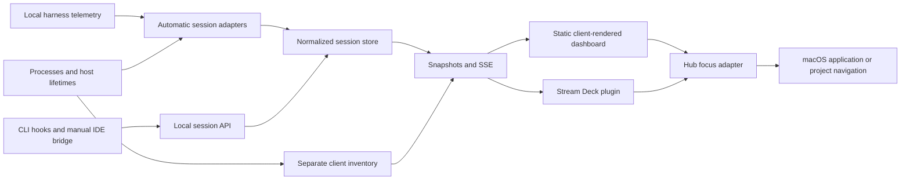

# Architecture anchor specification

## Purpose and authority

AI AI Captain is a local-first, tool-agnostic inventory of individual AI sessions, with a Stream Deck control surface and a browser dashboard. The architecture separates discovering and understanding sessions from displaying and navigating them.

This document owns component boundaries, data ownership, technology choices, and architectural constraints. Related anchors are [functionality.md](functionality.md), [design.md](design.md), and [intagration.md](intagration.md). `intagration.md` intentionally retains the requested filename.

Status terms used throughout these anchors:

- **Implemented**: present in the repository's runtime code.
- **Required**: an agreed product behavior that is not necessarily implemented yet.
- **Proposed**: an alternative or implementation detail awaiting a decision.

Specifications describe intended behavior; implementation status must remain explicit. A mockup, client process, or installed plugin is not evidence that an integration works. Changes to these contracts must update the relevant anchors and their verification criteria.

## ARCH-01 — System boundaries

The hub owns session identity, lifecycle evidence, persistence, and OS navigation. Consumers do not inspect harness transcripts or implement independent discovery. The browser and Stream Deck are projections of the same normalized inventory.

### Hub process lifetime

**Implemented.** The Stream Deck plugin supervises the hub. The hub stays a separate process with its own HTTP boundary.

- When the plugin starts, it examines `/health` at its hub URL. If a hub answers, the plugin uses that hub and does not start a second hub.
- If no hub answers, the plugin starts the bundled hub (`bin/hub.cjs`) as a child process. It uses the Stream Deck Node.js runtime.
- When the supervised hub stops, the plugin starts it again. The delay starts at 1 second and doubles after each failure, to a maximum of 30 seconds. After 60 seconds of stable operation, the delay starts at 1 second again.
- When an external hub stops, the plugin examines it again after 3 seconds. The plugin starts its own hub only after two failed checks. This prevents a port conflict while `npm run dev` restarts.
- The supervised hub stops when the plugin stops. It also stops when its parent process changes, for example after a plugin crash.
- A hub failure does not stop the plugin. The keys show UNK until the hub answers again.

The dashboard and reporters are available only while a hub runs. With supervision only, the hub runs only while the Stream Deck app runs.

## ARCH-02 — Technology baseline

| Layer                    | Implemented technology                                                                                           | Responsibility                                                                             |
| ------------------------ | ---------------------------------------------------------------------------------------------------------------- | ------------------------------------------------------------------------------------------ |
| Hub and reporters        | TypeScript, Node.js 24+ for development, Fastify, Zod; the plugin bundle runs on the Stream Deck Node 20 runtime | Discovery, normalization, validation, HTTP API, persistence, focus                         |
| Browser                  | Static HTML/CSS, TypeScript Web Component, Web Awesome, esbuild                                                  | Client-side rendering, diagnostics, key preview, SSE                                       |
| Browser shell            | Web manifest and service worker                                                                                  | Installable/cached static shell, not cached session APIs                                   |
| Stream Deck              | TypeScript, official `@elgato/streamdeck` SDK, bundled CommonJS targeting Node 20                                | Key allocation, images, attention timers, focus/dashboard actions, hub process supervision |
| Optional IntelliJ bridge | Kotlin, IntelliJ Platform, Gradle, JDK 21                                                                        | Manual per-project reporting fallback                                                      |
| Tests and builds         | Vitest, TypeScript compiler, esbuild, Stream Deck CLI                                                            | Regression tests, type checking, packaging and validation                                  |

**Implemented:** `npm run reload:streamdeck` finds the Stream Deck CLI on `PATH` or in npm's global prefix. It enables developer mode, links the built plugin package, and restarts the plugin. If the package is already linked, it continues to restart. If it cannot find the CLI, it shows the install command and stops. Tests verify CLI lookup, linking, restart, and missing-CLI handling.

**No server-side rendering is permitted.** Serving static files from Fastify does not make the UI server-rendered. No cloud account, database service, React runtime, or external rendering server is required.

Automatic OS discovery and navigation are currently macOS integrations. The generic HTTP API, reporters, and static dashboard can operate without macOS discovery; that does not imply cross-platform window focusing.

## ARCH-03 — Component map

| Location                                                                   | Ownership                                                                                                                |
| -------------------------------------------------------------------------- | ------------------------------------------------------------------------------------------------------------------------ |
| `src/shared/session.ts`                                                    | Runtime-validated session, focus-target, client, and event contracts                                                     |
| `src/shared/attention.ts`                                                  | Completion-age and attention schedule shared by both consumers                                                           |
| `src/shared/card-design.ts`, `card-assets.ts`, `palette.ts`, `settings.ts` | Shared SVG geometry, generated artwork/tokens, palette lookup, and validated appearance contract                         |
| `src/shared/hooks.ts`                                                      | Generic hook identity and lifecycle normalization                                                                        |
| `src/shared/diagnostics.ts`                                                | Plain-language state explanations                                                                                        |
| `src/server/discovery.ts`, `processes.ts`, `lifetimes.ts`                  | Shared process inventory, host attribution, terminal/project lifetime evidence                                           |
| `src/server/copilot.ts`, `codex.ts`, `events.ts`                           | Harness-specific ownership and event reducers; incremental JSONL reading                                                 |
| `src/server/claude.ts`                                                     | Live Claude Code registrations, process identity, and host-lifetime filtering                                            |
| `src/server/claude-desktop.ts`                                             | Experimental exposed-chat Accessibility inspection; only conversation IDs and state leave the inspector                  |
| `src/server/store.ts`, `clients.ts`, `settings.ts`                         | Canonical session store, separate app-presence registry, and persisted hub-wide palette and flash-intensity settings     |
| `src/server/app.ts`, `main.ts`, `focus.ts`                                 | Static/API hosting, startup/configuration, macOS navigation                                                              |
| `src/server/parent-process.ts`                                             | Supervised-hub shutdown when the parent plugin process stops                                                             |
| `src/server/dashboard.ts`                                                  | Default-browser detection, dashboard-tab reuse, and system URL-opening fallback; separate from session focus/assessment  |
| `src/cli.ts`                                                               | Generic metadata reporter and hook entry point                                                                           |
| `streamdeck/src/plugin.ts`                                                 | SDK lifecycle, per-device layout/paging, polling and actions                                                             |
| `streamdeck/src/hub-supervisor.ts`                                         | Hub health checks, start, restart delay, and stop of the supervised hub process                                          |
| `streamdeck/src/cards.ts`, `images.ts`                                     | Shared SVG card presentation and image encoding                                                                          |
| `web-src/`, `web/`                                                         | Browser source and served/bundled static assets                                                                          |
| `intellij-bridge/`                                                         | Optional manual IDE reporter                                                                                             |
| `docs/design/`                                                             | Visual references, canonical palette/icon sources, and artwork notices; runtime assets are generated and bundled locally |

The browser currently imports the shared card renderer from `streamdeck/src/cards.ts`. Its physical location must not be mistaken for permission to add hardware-only dependencies to that renderer.

## ARCH-04 — Domain model

An application, runtime process, session, model, and turn are different entities:

- A **client** identifies a detected application whose conversations may not be observable.
- A **runtime** may own multiple independent sessions and can outlive a terminal or project.
- A **session** is a stable conversation/work context, not an application window or individual message.
- A **turn** is one unit of work within an open session.
- A **model** is session metadata and can change without changing session identity or harness branding.

The implemented `SessionInput` contains required `id`, `source`, `label`, and `state`; optional `harness`, `model`, `project`, `focusTarget`, `metadata`, and `ended`; and no transcript field. `FocusTarget` can describe an app name/path, bundle ID, PID, or HTTP(S) URL. The schema is the executable source for field limits.

The store adds these distinct timestamps:

| Field | Meaning |
| --- | --- |
| `createdAt` | When the hub first created that stored record |
| `updatedAt` | When the latest report/update reached the store |
| `lastActivityAt` | Adapter-observed event time, or receipt time when a reporter supplies no event clock |
| `stateChangedAt` | Time of the actual observed state transition, used for completion age |

Reports, model changes, token counts, and polling must not masquerade as a fresh completion. `ended: false` keeps a completed/failed conversation open; completion and closure are independent concepts.

## ARCH-05 — Discovery and normalization

The discovery loop starts immediately and then runs every 1.5 seconds, without overlapping scans. Copilot, Codex, and Claude Code share a process inventory and host-lifetime inspector. Claude Code reads live session registrations and the end of the transcript, only to keep the model name and token counts. A separate Claude desktop adapter reads exposed conversation URLs and known Accessibility control labels. Each adapter sends only session metadata to the store.

Claude desktop inspection has a four-second timeout and a 6000-element limit. It does not read text-field values or message text. Hidden conversations and remote Code runtimes are not inferred from app presence. Desktop chat support is experimental until the installed app exposes the required URL and controls.

The JSONL cursor replays a file initially, then reads appended bytes. It handles incomplete lines, malformed records, replacement, and truncation. Reads use 64 KiB buffers; records over the 8 MiB line limit are skipped. Unsupported or unavailable telemetry must not be guessed to mean working.

Ownership is necessary but insufficient. Host-lifetime filtering additionally considers revoked terminal descriptors, known app ownership, and supported JetBrains project registrations. It suppresses history from previous project openings until a fresh session/turn trigger occurs. Lack of lifetime evidence is `unverified`, not proof of closure. Detection details and coverage limits belong to [intagration.md](intagration.md).

When multiple IntelliJ IDEA processes run, Junie navigation targets the process whose project registration is open.

## ARCH-06 — Transport and rendering

The implemented hub listens on `127.0.0.1:43681` by default. Consumers use:

- HTTP snapshots and commands through the local API.
- SSE for browser inventory changes, with a complete snapshot on each new connection and 15-second comment heartbeats. It is not a durable replay log.
- A 1.5-second HTTP snapshot poll in the Stream Deck plugin; the plugin does not currently consume SSE.

Key animations are local presentation timers, not extra discovery or HTTP requests. Hardware images use base64-encoded SVG data URIs. State/type changes, palette selection, flash intensity, and attention phases drive image signatures, avoiding unnecessary redraws and animation-frame logs.

Shared icons are flattened into transformed path groups with explicit fill/stroke colors. Each key image has one root SVG viewport: nested SVG elements and inherited `currentColor` must not be used for hardware artwork. Browser rendering alone is not sufficient compatibility verification; inspect the Stream Deck application preview after renderer changes.

The hub also serves a standalone deck page at `/deck.html` with its own manifest. It draws a virtual Stream Deck with the same key images and key numbers as the plugin. The grid is at most 8 columns by 4 rows. It becomes smaller to fit the window and the number of keys. It shows the PREV and NEXT keys only when the keys do not fit. A toolbar makes the keys smaller or bigger (32 to 160 pixels) and has a single-row mode. The page saves these settings in `localStorage`. It uses SSE and works without a Stream Deck. The layout rule is in `src/shared/deck-layout.ts`.

**Implemented:** the deck's **Keep on top** button uses the browser's Document Picture-in-Picture API after a user click. It moves the existing deck controls into a floating window and loads the same local stylesheet. The original component keeps its session stream, attention timer, page, and size settings. Closing the floating window returns the controls to the original page. The original page must stay open. Unsupported browsers show a disabled button and an explanation. Failed requests show a safe error code.

The optional `npm run deck:app` command detects macOS or Linux and starts Google Chrome or Chromium in app mode. macOS requests a new Chrome instance so app arguments reach Chrome when it is already running. Linux uses the first supported browser command on `PATH`. The command reports a missing browser or an unsupported operating system.

The command checks the deck page before it opens Chrome. This local check ignores curl configuration and proxy settings. Each request has a one-second limit. After 50 failed checks, the command reports a startup error.

The service worker caches the static shell and explicitly excludes `/api/` requests. A cached shell or last browser snapshot is not fresh lifecycle evidence.

## ARCH-07 — State and persistence ownership

`SessionStore` is the canonical owner of displayed session records. It publishes `upsert` and `remove` changes and serializes metadata to `sessions.json`. Client presence remains separate and cannot create a session key by itself.

The default data directory is `~/Library/Application Support/ai-ai-captain`. When only the directory of an earlier installation (`~/Library/Application Support/ai-deck`) exists, the hub moves it to the default directory at start. A configured `AI_AI_CAPTAIN_DATA_DIR` disables this move. Session and host-lifetime files use owner-only file creation permissions and temporary-file/rename persistence. `settings.json` persists the shared icon palette and flash intensity. Settings writes are serialized and atomically renamed before notification; failed saves retain the prior values. Browser SSE snapshots/changes and the plugin's existing session snapshots carry settings without new animation-driven requests. `host-lifetimes.json` remembers registration coverage and runtime-to-host identity, including process start identity rather than trusting a PID alone.

Restored sessions remain hidden until a live adapter/reporter confirms them. Persisting a `working` value must not resurrect a running session after restart. Automatic adapters remove confirmed closed hosts/projects promptly; ordinary session closure uses the ten-second grace period described in [functionality.md](functionality.md).

**Required, not implemented:** assessed DONE must be owned and persisted by the hub, associated with a particular session completion, and projected consistently to every consumer. It must not be a plugin-only local flag. Exact fields and API commands are still an implementation decision; the current schema has no assessment contract.

## ARCH-08 — Privacy and trust boundaries

- Existing local event files may be read transiently to derive metadata. Prompts, responses, instructions, tool contents, private error messages, and registry RPC tokens must not be retained or forwarded by automatic adapters.
- Claude registrations retain only validated session, process, project, model, status, and timestamp fields. The desktop inspector returns only conversation IDs and states. It never changes Accessibility permissions, starts a model turn, or reads authentication storage.
- Arbitrary API `label`, `project`, and `metadata` strings are not a secret-redaction service. Reporters must send descriptive metadata only.
- User processes and harness history settings must not be modified or terminated to make the inventory appear correct.
- Focus commands are issued by the hub, with argument-based process execution, target validation, and bounded command execution.
- Local access is the current deployment boundary. There is no application authentication/remote-access security layer; loopback binding must not be presented as authorization for every local process. Exposing the hub remotely requires a separate security design.
- Icons/themes are bundled locally with appropriate notices; no runtime CDN dependency is required.

## ARCH-09 — Extension and verification rules

A new automatic adapter must prove session identity, lifecycle semantics, ownership/closure evidence, privacy filtering, and recovery behavior before being called supported. It feeds the same session model; consumers should not require vendor-specific telemetry access.

At minimum, changes affecting these boundaries should exercise `npm test`, `npm run typecheck`, and `npm run build`. The plugin runs the hub on the Stream Deck Node 20 runtime. Hub code must therefore use only ES2023 language features and Node 20 APIs. Plugin changes also require Stream Deck package validation and readable 72-pixel visual review. Browser source changes require browser-source type checking as documented in [intagration.md](intagration.md).

Architectural acceptance includes: no SSR; no fake sessions from app presence; shared state semantics; no transcript persistence; no automatic revival of stale history; and no coupling of session discovery to physical key locations.
