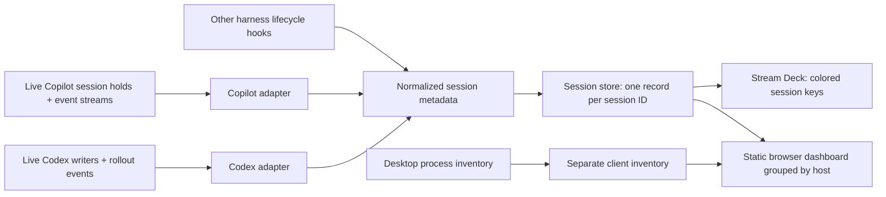

# Individual session tracking

This implementation note is supplemented by the root [architecture](../architecture.md), [functionality](../functionality.md), [design](../design.md), and [integration](../intagration.md) anchors, which distinguish current coverage from outstanding requirements.

## Summary

The original app scanner and manual IDE bridge did not satisfy automatic per-conversation monitoring. A live process only establishes client presence. Session identity and running/waiting state must come from lifecycle telemetry. The current Copilot installation provides separate local event streams and open hold files for several conversations owned by one IntelliJ runtime.

JetBrains AI Assistant's Codex sessions use a separate runtime and event format; Copilot telemetry cannot represent them. The Codex adapter now follows live writer/rollout ownership and incremental Codex rollout events, independently of the Copilot adapter. Missing rollout telemetry remains unknown rather than being inferred from the IDE process or model name.

Claude Code now uses live session registrations and shared host-lifetime filtering. CLI, IntelliJ, and local desktop Code runtimes retain independent session IDs. An experimental desktop adapter follows exposed chat URLs and known Accessibility controls. It does not discover hidden conversations or remote Code runtimes. See [integration limits](../intagration.md#claude-adapters).

## Concept

## Breakdown

- Identify a Copilot conversation by its session ID and an open hold file belonging to the owning runtime. Stale files alone are insufficient.
- Incrementally reduce session events into starting, working, waiting, failed, done, or unknown. Retain only metadata and event times, without storing prompts, responses, or tool contents.
- Reserve amber waiting for a required action. A completed turn is blue done with `ended: false` and remains visible; actual closure sets `ended: true` and expires after ten seconds.
- Resolve the host application through process ancestry; several sessions may share a runtime and host while retaining independent models and states.
- Separate client presence from sessions in the API and dashboard. Unsupported desktop clients do not consume session keys.
- Require live confirmation after restart and use unknown when telemetry fails, so cached working values cannot claim activity indefinitely.
- Use large type/host icons and state symbols/colors on physical keys. Match key numbers to full session/project/model details and a live key preview in the browser. Preserve key order through activity changes.
- Focus IntelliJ's matching project window through its command-line launcher and absolute project path. Use the owning application bundle when available, and report failures on the key instead of silently falling back to app-only activation. Conversation-tab selection remains separate work.

## MVP

Automatic tracking covers the installed Copilot, Codex, and Claude Code CLI/IntelliJ formats on macOS. Claude local desktop Code runtimes use the same registration adapter. Regular desktop chat has an experimental exposed-chat Accessibility adapter. Hidden chats and remote Code runtimes still need further integration. The dashboard remains client-rendered. The generic reporter and manual IntelliJ bridge remain alternatives for unsupported telemetry.

## Tasks

- [x] Add live Copilot ownership discovery and process ancestry.
- [x] Replay and incrementally follow each session's event stream.
- [x] Handle permissions, errors, closure, partial writes, truncation, and telemetry failure.
- [x] Separate desktop clients from session records and suppress stale restored activity.
- [x] Require stable session IDs from generic hooks.
- [x] Render independently colored session keys with large type/state symbols and stable order.
- [x] Remove small session-name text from keys; put numbered session details and a shared key preview in the dashboard.
- [x] Group browser sessions by hosting application and display unsupported clients separately.
- [x] Document setup, event mapping, privacy behavior, and coverage limits.
- [x] Complete build, automated checks, plugin validation, 72-pixel visual review, and live verification.
- [x] Add project-aware IntelliJ focus and propagate failures to Stream Deck keys.
- [x] Track JetBrains AI Assistant/Codex and Codex CLI sessions independently through live ownership and local turn events; test state, metadata privacy, telemetry failures, and closure.
- [x] Separate action-required WAIT from completed/idle DONE across Copilot, Codex, and generic hooks; retain completed open sessions.
- [x] Preserve actual state-transition timestamps; decay blue completion flashes over ten minutes, then retain steady dark-blue DONE without resetting on refresh/restart.
- [x] Explain unknown and other states with safe telemetry diagnostics/evidence in the static dashboard; provide a dedicated, manually positioned dashboard action without automatically appending INFO. Session paging adapts to the configured session-key capacity.
- [ ] Add automatic adapters for other harnesses and desktop applications where telemetry is available.
- [ ] Add conversation-level focus inside supported IDE/app integrations.
