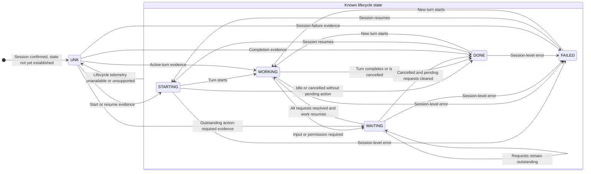
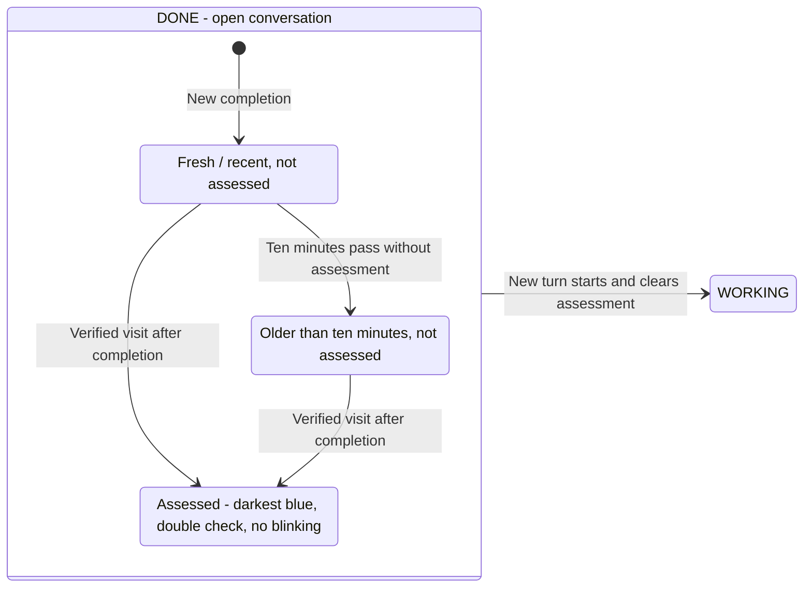

# Functionality anchor specification

## Purpose and status

AI AI Captain lets the user see individual AI sessions across harnesses and models, understand whether action is needed, and navigate to the relevant work context. Its intended scope includes CLI sessions, embedded IntelliJ sessions, and desktop AI applications.

This anchor owns observable behavior and acceptance criteria. See [architecture.md](architecture.md) for boundaries, [design.md](design.md) for visual meaning, and [intagration.md](intagration.md) for actual adapter coverage and setup. **Implemented**, **Required**, and **Proposed** distinguish shipped behavior, agreed work still outstanding, and undecided alternatives.

## FUNC-01 — Individual session inventory

**Implemented for supported automatic adapters and explicit reporters.**

- Every conversation has its own stable ID, state, harness, and optional model/project/focus metadata. Several sessions may share one runtime or application.
- Session titles, model names, process presence, and open files unrelated to ownership must not be used as substitutes for conversation identity.
- A model change updates metadata, not session identity. A Claude model inside Copilot remains a Copilot session.
- Newly confirmed sessions enter the hub inventory and fill configured session keys automatically. They do not require manually creating another hardware action for each conversation.
- Unsupported desktop applications appear under **Other detected apps**, not as fabricated session records. On Stream Deck they use app keys (FUNC-07), which are not sessions.

| Workflow                                                 | Current coverage                                                                                                                        |
| -------------------------------------------------------- | --------------------------------------------------------------------------------------------------------------------------------------- |
| Copilot CLI and IntelliJ Copilot runtime                 | Automatic individual sessions from supported local telemetry                                                                            |
| Codex CLI and JetBrains AI Assistant's Codex ACP runtime | Automatic individual sessions from supported local telemetry                                                                            |
| Codex in the ChatGPT desktop app                         | Automatic individual sessions with the Codex desktop app badge; plain ChatGPT chats are not tracked                                     |
| Junie in IntelliJ IDEA                                   | Automatic sessions from `~/.junie/sessions` while the project is open; WAITING is not shown; Junie CLI outside IntelliJ is not detected |
| Claude Code CLI and IntelliJ Claude runtimes             | Automatic sessions from live local registrations; requires a supported registration format                                              |
| Claude Code in the desktop app                           | Same registrations with Claude app ancestry; remote/isolated runtimes need a reporter                                                   |
| Other IntelliJ AI workflows                              | Optional manual bridge, one reported task per project; not automatic conversation discovery                                             |
| Claude desktop chat                                      | Experimental exposed-chat adapter using Accessibility conversation URLs and known English controls; hidden chats remain unsupported     |
| ChatGPT and Microsoft Copilot desktop plain chats        | App presence only (APP key); session adapters not implemented                                                                           |

Illustrated icons do not expand this coverage matrix.

Claude Code registration status supplies its state. `busy`, `running`, and `working` mean WORKING. Explicit input or permission states mean WAITING. `idle` and `done` mean DONE. Unsupported status values mean UNKNOWN.

Versions that omit approval status cannot expose that pause through this adapter. Missing model metadata stays **Not observed**.

The desktop chat adapter requires an exposed `https://claude.ai/chat/<UUID>` URL. Enabled Stop controls mean WORKING. Known approval controls mean WAITING. An enabled composer and a Send control, without activity or approval controls, mean DONE. Other controls mean UNKNOWN.

The adapter does not inspect response text to guess failure or completion. Desktop transition times are observation times, not server completion timestamps.

Confirmed Claude runtime exit, registration removal, app exit, or removal of an exposed desktop chat removes its key. Failed inspection retains previously confirmed chats as UNKNOWN. A desktop app with no identifiable exposed chat remains under **Other detected apps** with a tracking explanation.

## FUNC-02 — State semantics

The public lifecycle enum remains independent of presentation wording:

| API state | Required key wording | Meaning |
| --- | --- | --- |
| `starting` | STARTING | Session started/resumed; an active turn is not yet established |
| `working` | WORKING | A supported signal reports an active turn or tool operation |
| `waiting` | WAITING | Input, approval, permission, or another user action is needed |
| `done` | DONE | Work finished or was cancelled; no action is currently required |
| `failed` | FAILED | A session-level failure was reported |
| `unknown` | UNK | Available evidence cannot establish a supported current state |

The shared runtime renderer implements STARTING/WORKING/WAITING/DONE/FAILED/UNK with the approved harness/host artwork. Domain/API state values are unchanged.

A completed turn is not WAITING. A recoverable tool error is not automatically a failed session. Permission/input requests remain WAITING until the outstanding requests are resolved. Unsupported events cannot invent activity; an explicitly supplied generic hook name that cannot be classified maps to `unknown`.

The ordinary path is starting → working → waiting → working → done, but supported telemetry can establish a state without every preceding event being available. Another turn resumes work; failure and unknown states can recover when evidence returns.

### Lifecycle state machine

Transitions are driven by supported evidence, not elapsed time or app presence. The enclosing **Known lifecycle state** group is a diagram boundary, not an additional API state. Entry and recovery from UNKNOWN can establish any supported state directly.

Completion transitions to DONE require no remaining user action. A turn-end notification while input/permission requests remain outstanding stays WAITING. Metadata-only changes do not advance this state machine. Losing only project-lifetime evidence does not by itself invalidate otherwise supported lifecycle evidence.

Closure is separate from these six API states: a completed open conversation stays DONE; explicit session shutdown/loss of ownership starts the closing grace period, while confirmed host/project/terminal closure removes the record on the next successful scan. Those rules apply to known and unknown sessions; see FUNC-03.

### DONE presentation substates

The lifecycle state remains `done` throughout this diagram. Fresh/aged completion behavior is implemented; **assessed DONE is required but not implemented**, as detailed in FUNC-05. Bright/dim animation frames are not additional lifecycle states.

Assessment can occur at any completion age; it does not require waiting ten minutes. Reconnection, polling, or restored state preserves the original completion age and, once implemented, its assessment instead of starting a new completion. A visit before completion or broad app/project activation cannot trigger the assessed transition.

## FUNC-03 — Completion versus closure

**Implemented.**

1. Finishing a turn leaves the conversation visible as `done` with `ended: false`.
2. A failed but open session likewise remains visible and can recover.
3. Explicit shutdown or loss of live session ownership ends the record; it normally remains for ten seconds before removal.
4. Confirmed project, terminal, or owning-app closure removes affected automatic sessions on the next successful scan, without a new completion alert. Other open projects/sessions remain visible.
5. Old held session files must not reappear merely because a project reopens. A fresh start/resume/turn trigger during that opening is required.
6. Restored persisted sessions remain hidden until reconfirmed by an adapter/reporter.

Per-project filtering depends on supported registration evidence. Missing or unreadable lifetime telemetry must not be treated as confirmed closure. Ordinary inactivity after DONE does not remove an open conversation. Explicit API reporters must report closure themselves; they do not automatically inherit the filesystem adapters' host checks or a generic lease timeout.

Legacy `done`/`failed` API reports without an explicit `ended` value retain their ten-second expiry. Reporters intending an open completed conversation must send `ended: false`.

## FUNC-04 — Attention and completion age

**Implemented for unassessed completions.**

- WAITING alternates between bright and dim amber every 1.2 seconds, a 2.4-second cycle.
- Fresh DONE flashes quickly, then less frequently over ten minutes. After ten minutes it remains steady dark blue.
- DONE age derives from the actual completion/state transition, not `updatedAt`, polling, token counts, or model changes.
- A later working turn followed by completion starts a fresh completion alert.
- Browser reduced-motion settings suppress flashing while retaining meaningful state and completion aging.
- No additional hub requests are issued for animation frames.

Exact timing and color-role contracts belong to [design.md](design.md).

## FUNC-05 — Assessed DONE

**Required and illustrated; runtime tracking and persistence are not implemented.**

Assessment is a DONE substate: the user visited this specific session after its current result finished, so that result is presumed reviewed. It is not a claim that the user actually read every word.

- Assessment must immediately stop the completion alert, at any completion age.
- Assessed DONE must be darker than unassessed DONE older than ten minutes and use a double check as a non-color distinction. The key remains labeled DONE.
- A visit before completion cannot pre-assess a future result. Merely activating an app/project cannot assess every conversation it contains.
- A verified session-specific visit or explicit assessment action can acknowledge the completion. Failed navigation cannot do so. A project-level focus result is not conversation-level proof.
- Assessment belongs to a session and a specific completion, not to the model, process, project, or application.
- Another turn clears assessment; the next completion is fresh. Polling, metadata updates, and elapsed time cannot assess a result.
- The original completion timestamp must remain unchanged. Assessment must survive hub/plugin restarts and propagate to browser and hardware consumers.
- Assessment neither ends nor removes the conversation; the key remains focusable.

The exact assessment API, persistence fields, and supported visit-detection mechanisms are still to be implemented. Existing focus calls do not currently record assessment.

## FUNC-06 — Navigation

**Implemented:** pressing a populated session key or browser focus control asks the hub to activate the recorded target. IntelliJ sessions with valid absolute project paths use project-specific navigation and the exact owning installation when known. Other targets may only support application-level activation.

The response distinguishes application/project focus where available and reports failures. Stream Deck shows an alert on a failed request. After a failed press, a second press on the same key within ten seconds asks the hub to remove that stale session. Invalid/unavailable project paths must not silently fall back to generic app focus. IntelliJ navigation may reopen an available closed project if the record still exists during a closing interval or comes from a reporter.

**Implemented for identified Claude desktop chats:** the restricted `claudeConversationId` focus field opens the existing chat through its Claude deep link. This navigation request does not prove that the user read the result. It does not assess DONE.

**Required for IDE session navigation:** selecting the exact conversation/tab inside an IDE. Project focus must not be advertised as conversation selection or proof of assessment. Claude CLI and local desktop Code sessions retain application-level focus.

## FUNC-07 — Stream Deck layout and paging

**Implemented.**

- The default XL profile contains 30 AI Session actions and two paging actions.
- Users can place session, dashboard, paging, and unrelated controls in custom positions.
- Sessions fill configured AI Session keys in reading order, skipping other action types without skipping conversations. Up to 30 session keys are used per device.
- Paging capacity follows the actual number of configured session keys. Previous/next paging wraps and is independent per device.
- Logical session order is creation time, then stable ID. State changes do not reorder it. Removing sessions or changing layout can compact assignments; permanent physical pinning is not promised.
- **Implemented:** after all sessions, each detected app without session tracking fills one AI Session key. Apps sort by name. An app key shows the app icon, the key number, and the label APP, in the control style. It never shows a state. Paging counts sessions and app keys together.
- Pressing an app key asks the hub to focus the app (`POST /api/clients/:id/focus`). A failed press shows an alert. App keys cannot be removed.
- Empty session keys stay empty and do not perform focus or dashboard navigation.
- INFO is a separate **Open AI AI Captain Dashboard** action, manually placed wherever desired. It never appears automatically after the last session or migrates when sessions arrive.
- The dashboard shortcut opens the configured hub URL even when session polling cannot connect.
- With a reachable upgraded macOS hub, INFO detects the current default browser and selects its matching dashboard tab. The adapters verify the configured URL and do not read webpage contents. The hub combines concurrent requests into one operation. If reuse fails or no match exists, the hub opens the configured URL through the default browser. This fallback can create a new tab. The plugin uses its system opener if the hub is unavailable or reports failure. INFO shows an alert only if that opener also fails.
- Reloading a linked plugin must not replace the user's customized layout or require profile reimport.

## FUNC-08 — Dashboard and diagnostics

**Implemented.** The dashboard is entirely client-rendered and provides:

- A live session count, host grouping, session/model/project details, and navigation controls.
- Logical key numbers and previews using the same session-card renderer as the hardware. The preview is not a reproduction of every custom physical layout/page.
- Plain-language state explanations and expandable **State details & evidence**; UNKNOWN details open by default.
- Tracking source, event, telemetry status/location, safe filesystem error code, event/report/state-change times, owner/host PIDs, and available host/project lifetime evidence.
- Explicit **Not observed**/unavailable descriptions instead of fabricated model, project, or state data.
- Separate app-presence entries for clients without conversation telemetry.
- A visible connection/reconnection indication. A cached shell or retained last snapshot is not proof of current work.
- An **Icon palette** selector for Fjord (default), Nocturne, Ember & Ice, Signal, and Porcelain. One saved hub-wide choice applies to every browser preview and all session, empty, INFO, and paging keys, survives restarts, and requires no profile reimport/reload after the initial upgrade. Browser changes arrive by SSE; hardware changes arrive on the next normal poll. Saving errors retain the prior choice; palette changes must not restart attention timers or alter session/layout state.
- The standalone deck has a **Keep on top** button for an always-on-top Document Picture-in-Picture window. The user must click the button. The floating window keeps live updates, key actions, paging, and size controls. **Return to deck**, or closing the floating window, restores the existing deck. The original page must stay open. Unsupported browsers show an explanation. Failed requests allow another attempt without showing private browser errors.

Diagnostics must not display transcripts, prompts, tool arguments/results, registry authentication tokens, or private harness error messages. Missing, unreadable, unrecognized, and discovery-unavailable telemetry are distinguishable conditions.

## FUNC-09 — Responsiveness and failure handling

The automatic hub scan and hardware snapshot poll each normally run every 1.5 seconds. A change often reaches Stream Deck in about three seconds plus inspection/rendering time; this is not a hard real-time guarantee. Browser changes are pushed through SSE after hub updates.

When hardware polling fails, previously known sessions become UNKNOWN rather than continuing to blink as stale WAITING or DONE alerts. **Implemented:** the Stream Deck plugin starts the hub when no hub answers, and starts it again after a failure (see ARCH-01). The user does not start the hub manually when Stream Deck runs. When adapter discovery fails, affected tracked states become unknown and scanning retries. Lack of project-lifetime evidence alone does not erase otherwise supported lifecycle evidence or prove the project closed.

## FUNC-10 — Acceptance scenarios

Implemented behavior must retain regression coverage for:

1. Two conversations in one runtime showing independent models/states and reacting independently to new work.
2. Completed open sessions remaining visible; actual closure removing them without harming an active project.
3. Closing a CLI terminal despite an orphaned runtime; reopening a project without resurrecting its history.
4. Missing telemetry showing UNKNOWN and recovering when evidence returns; stale restored records staying hidden.
5. A custom INFO key staying fixed while session keys fill around it, including paging and focus without gaps.
6. WAITING and DONE animation timers not increasing HTTP polling or resetting completion age.
7. INFO reusing a verified dashboard tab when possible and opening through the default browser when reuse fails. Denied permissions, unsupported browsers, inspection errors, and invalid responses must use the fallback. A successful hub fallback must not cause another plugin open request.
8. The optional `deck:app` command detecting macOS or Linux, starting Chrome or Chromium in app mode, and reporting unsupported operating systems or missing Linux browsers.
9. The `deck:app` readiness check bypassing proxies and limiting each request to one second before it opens Chrome.
10. The deck entering and leaving Picture-in-Picture without replacing its session stream or losing its controls and settings. Resize handling must use the active window. Unsupported browsers and rejected requests must show safe, accessible messages.

Claude regression coverage verifies independent registrations, process identity, closure, recovery, completion age, and metadata filtering. Desktop tests verify exposed-chat identity, control-based state, denied permissions, removal, and restricted deep links. App presence and sidebar history must never create session keys.

Required additions must demonstrate:

1. Full display labels fitting 72-pixel keys and matching the approved icon system.
2. Assessed DONE stopping alerts, persisting per completion, resetting on new work, and never assessing unrelated conversations through app focus.
3. Full Claude desktop coverage for hidden chats, remote Code runtimes, additional languages, and unsupported UI versions. The experimental exposed-chat adapter does not satisfy this requirement.
