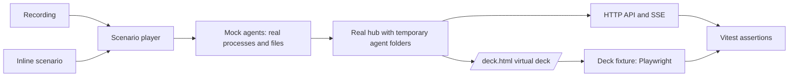

# End-to-end test harness

The harness runs the real hub against mock agents. A mock agent is a real process with the name that the hub looks for. It writes the files that the hub reads. Use the harness to test the full chain from the process list to the virtual deck.

Status: the harness is **Implemented** for Claude Code, Codex, Copilot, and Junie. Section 8 lists the items that are still **Required**.

## Contents

- [1. Quick start](#1-quick-start)
- [2. Run the tests](#2-run-the-tests)
- [3. Run the hub in simulation mode and run scenarios](#3-run-the-hub-in-simulation-mode-and-run-scenarios)
  - [3.1 Show a scenario on the virtual deck](#31-show-a-scenario-on-the-virtual-deck)
  - [3.2 Show a scenario on the physical deck](#32-show-a-scenario-on-the-physical-deck)
- [4. Write a scenario](#4-write-a-scenario)
  - [4.1 Agents and steps](#41-agents-and-steps)
  - [4.2 Expectations](#42-expectations)
  - [4.3 Deck steps](#43-deck-steps)
  - [4.4 Failures](#44-failures)
- [5. Export a session and write recordings](#5-export-a-session-and-write-recordings)
  - [5.1 Export a real session](#51-export-a-real-session)
  - [5.2 Content of an export](#52-content-of-an-export)
  - [5.3 Watch a live Claude Code session](#53-watch-a-live-claude-code-session)
  - [5.4 Other ways to get a recording](#54-other-ways-to-get-a-recording)
  - [5.5 Recording format](#55-recording-format)
- [6. Add an export to the test suite](#6-add-an-export-to-the-test-suite)
- [7. Design](#7-design)
  - [7.1 Architecture](#71-architecture)
  - [7.2 Hub under test](#72-hub-under-test)
  - [7.3 Mock agents](#73-mock-agents)
  - [7.4 Deck fixture](#74-deck-fixture)
  - [7.5 Fidelity and drift](#75-fidelity-and-drift)
  - [7.6 Platforms](#76-platforms)
  - [7.7 Tools](#77-tools)
- [8. Limits and missing items](#8-limits-and-missing-items)
- [9. Related documents](#9-related-documents)

## 1. Quick start

| Task                                    | Command                                                         |
| --------------------------------------- | --------------------------------------------------------------- |
| Install the browser (one time)          | `npx playwright-core install chromium`                          |
| Run all end-to-end tests                | `npm run test:e2e`                                              |
| Show scenarios on the virtual deck      | `npm run sandbox -- e2e/scenarios/codex-lifecycle.ts`           |
| Show scenarios on the physical deck     | `npm run sandbox:deck -- e2e/scenarios/codex-lifecycle.ts`      |
| Show a think, ask, fail, and finish run | `npm run sandbox -- e2e/scenarios/codex-agentic-interaction.ts` |
| List the sessions that you can export   | `npm run export:recording -- codex --list`                      |
| Export one session to a recording       | `npm run export:recording -- codex <session identifier>`        |
| Record a live Claude Code session       | `npm run export:recording -- claude --watch`                    |
| Play a recording on the virtual deck    | `npm run sandbox -- <file>.recording.json`                      |

The unit tests of the harness run with `npm test`. The scenarios run with `npm run test:e2e` only.

## 2. Run the tests

1. Install the dependencies with `npm install`.
2. Install the browser for the virtual deck once:

   ```sh
   npx playwright-core install chromium
   ```

3. Run the scenarios:

   ```sh
   npm run test:e2e
   ```

The tests start a real hub in a temporary folder. They do not change your files. The browser runs headless, so the tests need no display. To see the browser, set `AI_AI_CAPTAIN_E2E_HEADED=1`. CI ignores this setting.

The tests run on macOS and Linux. Windows cannot make mock agents yet. The Junie scenario runs on macOS only. CI runs the `e2e` job on Linux and macOS. A failed job uploads the recordings of the failed scenarios.

A test plays a recording at the fastest pace: it ignores the recorded times and the pauses, and it waits only until the hub shows each state. Only the sandbox plays in real time. The option `--fast` of the sandbox adds a 1-second wait after each check, so the tests do not use it. A test checks this.

The output of `npm run test:e2e` shows each test. A test that plays a recording prints `[recording] Playing <file>: <n> steps` and `[recording] Finished <file> in <seconds> s`. Set `AI_AI_CAPTAIN_E2E_VERBOSE=1` to print one line for each step too.

Put each scenario in `e2e/scenarios/`. Name a test file `<agent>-<topic>.e2e.test.ts`. The file `vitest.e2e.config.ts` finds it. `npm test` does not start the hub.

## 3. Run the hub in simulation mode and run scenarios

The sandbox starts a hub with mock agents and plays scenarios in real time. Use it to look at a scenario on a deck.

1. Stop every other hub. The sandbox stops when a hub listens on port `43681`.
2. Type this command:

   ```sh
   npm run sandbox -- [--port=<number>] [--loop] [--fast] [--settle=<duration>] <scenario module or recording> [more...]
   ```

3. Read the PASS and FAIL lines in the terminal.

A scenario module must export a list named `scenarios`. The files `e2e/scenarios/*-lifecycle.ts` are examples. A recording is a `.json` file. The sandbox waits 4 seconds after each state in these examples, so that people can see it. Add `--fast` to ignore the times in recordings and the pauses in scenarios. The sandbox then waits only 1 second after each check. Add `--settle=<duration>` to change that time, for example `--settle=2s`. The sandbox waits 5 seconds before each scenario, so that the deck can load. Add `--loop` to play the files again and again. Press **Control** and **C** to stop. Add `--port=<number>` to test while a real hub runs.

The sandbox sets `AI_AI_CAPTAIN_SANDBOX=1`. The hub then does not scan the Claude desktop application and does not list desktop applications. The sandbox also sets a short scan interval (`AI_AI_CAPTAIN_DISCOVERY_INTERVAL_MILLISECONDS`) and a focus log (`AI_AI_CAPTAIN_FOCUS_LOG`). The hub writes the focus commands to the log and does not run them. A mock host process thus never activates a real application.

### 3.1 Show a scenario on the virtual deck

1. Start the sandbox as in section 3.
2. Open <http://127.0.0.1:43681/deck.html>.

### 3.2 Show a scenario on the physical deck

The plugin uses a hub that already answers when the plugin starts. The sandbox hub must thus run before the Stream Deck app starts. This command does the steps for you. It works on macOS only.

CAUTION: THE COMMAND QUITS THE STREAM DECK APP. THE REAL HUB OF THE PLUGIN STOPS WITH IT. YOUR REAL SESSIONS DISAPPEAR FROM THE DECK UNTIL THE SANDBOX STOPS.

```sh
npm run sandbox:deck -- [<scenario module or recording>...]
```

The command quits the Stream Deck app and waits until port `43681` is free. It starts the sandbox hub in a loop. Then it starts the Stream Deck app. It never stops a hub by force. When you stop the command, the plugin starts its own hub again after a few seconds.

NOTE: `npm run demo:keys` is different. It sends sessions to the API only. The sandbox also runs the adapters.

## 4. Write a scenario

A scenario is a list of steps. Each step starts a mock agent, changes a file, or checks the hub. Declare the agents in the second argument of `scenario()`. The key of each agent is the name that the steps use.

```ts
import { codex } from "../harness/codex.js";
import { scenario } from "../harness/scenario.js";

await scenario("codex short life cycle", { cli: codex({ model: "codex-model" }) })
  .step("cli", (agent) => agent.spawn())
  .step("cli", (agent) => agent.startTurn())
  .expectSession("cli", { harness: "codex-cli", state: "working" })
  .step("cli", (agent) => agent.completeTurn())
  .expectSession("cli", { state: "done" })
  .run();
```

The editor shows the steps of each agent and the fields of a session. It rejects an agent name that the scenario does not declare. A scenario can use more than one agent. Use a different name for each agent.

### 4.1 Agents and steps

| Agent       | Factory        | Steps                                                                                                                                | Systems      |
| ----------- | -------------- | ------------------------------------------------------------------------------------------------------------------------------------ | ------------ |
| Claude Code | `claudeCode()` | `spawn({ status })`, `status(value)`, `registration.writeRaw(text)`, `exit()`                                                        | macOS, Linux |
| Codex       | `codex()`      | `spawn`, `turnContext`, `startTurn`, `tokenCount`, `requestPermission`, `approve`, `completeTurn`, `failTurn`, `releaseLock`, `exit` | macOS, Linux |
| Copilot     | `copilot()`    | `spawn`, `startTurn`, `requestPermission`, `approve`, `completeTurn`, `shutdown`, `exit`                                             | macOS, Linux |
| Junie       | `junie()`      | `spawn`, `startTask`, `requestInput`, `completeTask`, `failTask`, `exit`                                                             | macOS        |

A step gives one operation or a list of operations. The operations are `spawn`, `exit`, `write`, `append`, `holdOpen`, and `release`. The builder makes the same operations as a recording. Thus `.toRecording()` saves any inline scenario, and the sandbox plays it.

Each step takes optional overrides, for example `startTurn({ turnId: "turn-2" })`. Use `registration.writeRaw` to write a cut-off or unknown registration.

### 4.2 Expectations

| Method                        | Function                                                                           |
| ----------------------------- | ---------------------------------------------------------------------------------- |
| `.expectSession(key, fields)` | Wait until the session has these fields. Use `undefined` to wait until it is gone. |
| `.expectDeck(check)`          | Wait until the check passes for a snapshot of the deck.                            |
| `.expectFocus({ appName })`   | Wait until the hub tries to focus the application.                                 |
| `.wait("2s")`                 | Wait. Use it only for behavior that depends on time.                               |

Each expectation waits up to 15 seconds. The hub scans on a timer, so a state change takes time. Add `{ within: "30s" }` to change the limit. Add `{ during: "5s" }` to make sure that the value does not change.

### 4.3 Deck steps

Call `.deck({ viewport, palette, showInfoKeys, clock })` once to open the virtual deck in a headless browser. Then use these methods:

- `.expectDeck((deck) => ...)` examines `deck.key(n)`, `deck.infoFor(n)`, and the other keys.
- `.advanceDeckClock("10m")` moves the clock of the page forward, to age a DONE key. Set `clock: "manual"` in `.deck()`.
- `.pressKey(n)` presses a session key or an app key. The virtual deck calls the focus endpoint only. It does not mark a session as attended, as the Stream Deck plugin does.

### 4.4 Failures

When a step fails, the error shows the scenario name, the step number, the last sessions of the hub, and the last deck keys. It also shows the fake processes, the registration files, the error output of the fake processes, and the last output of the hub. The harness writes a `.recording.json` file with the steps until the failure. The error message gives its path. Attach this file to an issue report.

## 5. Export a session and write recordings

A recording is a JSON file with the steps of a scenario. The export script makes a recording from a real session. A person runs the script by hand. The hub does not run it.

### 5.1 Export a real session

```sh
npm run export:recording -- <codex|copilot|claude|junie> --list [--home=<folder>] [--limit=<number>]
npm run export:recording -- <codex|copilot|claude|junie> <session identifier or file> [--home=<folder>] [--out=<file>]
```

1. Make a list of the sessions. Each line has the session identifier, the time of the last change, and the file size. The newest session is first. The list shows no content. It shows 20 lines. Use `--limit` to change this.
2. Choose a session by its time and size.
3. Run the export with the identifier. The command writes `<agent>-<first 8 characters>.recording.json` in the current folder. Use `--out` to choose another name. The command never overwrites a file.
4. Open the file and read it before you share it.
5. Play it to check it: `npm run sandbox -- <file>`.

The script reads these files:

| Agent       | File                                          | Folder variable              |
| ----------- | --------------------------------------------- | ---------------------------- |
| Codex       | `~/.codex/sessions/**/rollout-*-<id>.jsonl`   | `AI_AI_CAPTAIN_CODEX_HOME`   |
| Copilot     | `~/.copilot/session-state/<id>/events.jsonl`  | `AI_AI_CAPTAIN_COPILOT_HOME` |
| Claude Code | `~/.claude/projects/<project>/<id>.jsonl`     | `AI_AI_CAPTAIN_CLAUDE_HOME`  |
| Junie       | `~/.junie/sessions/session-<id>/events.jsonl` | `AI_AI_CAPTAIN_JUNIE_HOME`   |

The option `--home` also changes the folder. Give the path of an event file in place of an identifier to use a file from another place.

### 5.2 Content of an export

The export has the sequence of events and nothing else.

- The recording keeps the type of each event and the time between events.
- The recording keeps the pairing of a turn, a request, or a call with its end. The script replaces each identifier with an alias such as `turn-1`.
- The recording has no prompt, response, tool argument, tool result, error message, token count, path, or session identifier.
- The header has a `context` block: the day of the session, the name of the model, and a few high-level settings. Examples are the permission mode and the sandbox mode. The script keeps a value only when it is a short word. A path or a sentence does not pass.
- The recording has `comment` fields. They tell a person what happens before and at the important states WAITING, DONE, and FAILED. The script writes each comment from a fixed phrase for the kind of event, for example "agent message" or "permission request to the user". A comment never has text from the session. The player ignores the comments.
- The script uses an allowlist. It copies a field only when the field is on the list. A new field of a new agent version is dropped until a person adds it.
- The expected part comes from the state reducer of the hub. The script replays the kept events through it.

Two exports are less exact than the others:

- **Claude Code.** The registration file has no history, so the export reads the transcript. A prompt gives `busy`, and the end of a turn gives `idle`. The transcript has no record of a permission request. Thus the recording never has the state `waiting`. To record the real statuses, watch the session while it runs (section 5.3).
- **Junie.** The export keeps the state names of the state events. Junie also writes `INPUT_REQUIRED`, which the hub shows as WAITING. The recording does not stop the mock IDE (refer to section 7.3).

NOTE: The expected states show what the current hub does with the events. If the hub is wrong, the recording is wrong too. Compare the states with what you saw in the real session.

The privacy test puts canary secrets in the files in `e2e/fixtures/export/`. It fails if a canary is in an export. Refer to ARCH-08 in [architecture.md](architecture.md).

### 5.3 Watch a live Claude Code session

Claude Code keeps its status (`busy`, `idle`, `permission_required`, and others) in `~/.claude/sessions/<pid>.json`. The file has no history. Only a watch during the session can record a change such as `permission_required`.

```sh
npm run export:recording -- claude --watch [<session identifier or process identifier>] [--out=<file>] [--interval=<milliseconds>]
```

1. Start the command in a second terminal, then use Claude Code as usual. With one running session, the identifier is not necessary. With more than one, the command lists them.
2. The command polls the registration file every 250 milliseconds. It prints each new status.
3. Stop with **Control** and **C**, or end the session. The command then writes the recording.

The recording keeps the status names and the time between changes. It drops all other fields of the registration, for example the project path and the name. It writes the file `claude-<first 8 characters>.recording.json`. The command never overwrites a file.

### 5.4 Other ways to get a recording

- **From a failed scenario.** Use the file that the error message names (section 4.4).
- **From an inline scenario.** Call `.toRecording()` and write the result with `JSON.stringify`. Deck steps and waits are not part of a recording.
- **By hand.** Copy `e2e/fixtures/claude-code/hand-written/lifecycle.recording.json` and change it.

### 5.5 Recording format

A recording has three parts:

- **Header**: format version, source, agent, agent version, and platform.
- **Timeline**: steps with an optional time offset, for example `3s` or `250ms`. Each step has one operation.
- **Expected**: the session states in sequence. A state of `null` means that the session must not exist.

A path or a value can have placeholders. The player replaces them for each run.

| Placeholder                                                                 | Value                                          |
| --------------------------------------------------------------------------- | ---------------------------------------------- |
| `{SESSION}`                                                                 | A new UUID for each agent                      |
| `{PID}`, `{T}`                                                              | Process identifier and start time of the agent |
| `{NOW}`, `{NOW_MS}`                                                         | The time now, as text or as a number           |
| `{HOME}`, `{CLAUDE_HOME}`, `{CODEX_HOME}`, `{COPILOT_HOME}`, `{JUNIE_HOME}` | Folders in the temporary folder                |
| `{JETBRAINS_INSTANCES}`, `{PROJECT_1}`                                      | Folders in the temporary folder                |

Add `:<agent key>` to a placeholder in a scenario with more than one agent, for example `{PID:cli}`. A path in a recording must stay inside the temporary folder. A process name can have folders but not `..`.

## 6. Add an export to the test suite

Use an export as a regression test for a defect, or as a fixture for an agent version.

1. Export the session (section 5.1). Read the file.
2. Make sure that the file has no private data:

   ```sh
   grep -c "/Users/" <file>
   ```

   The result must be `0`. Search for your user name and project names too.

3. Check the expected states. Change a state that is wrong. A bug report can come with the wrong state. The corrected file is then the regression test.
4. Move the file to `e2e/fixtures/<agent>/<agent version>/<topic>.recording.json`. The version is in the header of the file.
5. Add a test file `e2e/scenarios/<agent>-<topic>.e2e.test.ts`:

   ```ts
   import { fileURLToPath } from "node:url";
   import { describe, expect, it } from "vitest";
   import { isAgentSimulationSupported } from "../harness/agent-process.js";
   import { scenario } from "../harness/scenario.js";

   const recording = fileURLToPath(new URL("../fixtures/codex/0.162.1/permission.recording.json", import.meta.url));

   describe.skipIf(!isAgentSimulationSupported)("codex permission session", () => {
     it("gives the expected states", async () => {
       await expect(scenario.fromRecording(recording).run()).resolves.toBeUndefined();
     });
   });
   ```

6. Run `npm run test:e2e`. The test must pass.
7. Run the test again with a wrong expected state in the file. The test must fail with a clear message. Then correct the file.
8. To add steps after the recording, use `scenario.fromRecording(file).until("12s")` and continue with inline steps.
9. Run the checks that `AGENTS.md` section 7 lists.

To keep a mock agent correct for a new agent version, also make a shape file:

1. Read one real file of the agent, for example a Codex `rollout-*.jsonl` file.
2. Write the key names and the value types of each event type to `e2e/fixtures/<agent>/<version>/<name>.shape.json`. Do not write values.
3. Add a unit test that checks each event of the mock agent against the shape file. `e2e/harness/codex.test.ts` is an example.

## 7. Design

### 7.1 Architecture



One player runs all scenarios. A recording and an inline scenario make the same list of items. The player runs in three modes: Vitest (`npm run test:e2e`), sandbox (`npm run sandbox`), and replay of a recording.

### 7.2 Hub under test

The harness starts `src/server/main.ts` as a child process with `tsx`. It sets these variables to folders in one temporary folder:

- `AI_AI_CAPTAIN_DATA_DIR`
- `AI_AI_CAPTAIN_CODEX_HOME`
- `AI_AI_CAPTAIN_COPILOT_HOME`
- `AI_AI_CAPTAIN_CLAUDE_HOME`
- `AI_AI_CAPTAIN_JUNIE_HOME`
- `AI_AI_CAPTAIN_JETBRAINS_INSTANCES`
- `AI_AI_CAPTAIN_PORT` (a free port in tests)
- `AI_AI_CAPTAIN_SANDBOX`, `AI_AI_CAPTAIN_DISCOVERY_INTERVAL_MILLISECONDS`, and `AI_AI_CAPTAIN_FOCUS_LOG`

The hub changes for the harness are small and **Implemented**: `src/server/sandbox.ts` reads the three sandbox variables. The focus dry-run is in `src/server/focus.ts`. The deck buttons have `data-identity`, `data-state`, and `data-attention` attributes (`web-src/deck.ts`). Thus the tests do not depend on the wording of the label texts.

### 7.3 Mock agents

The hub finds an agent by its process name, by the files that the process holds open, and by the parent chain to the host application. A mock agent makes the same evidence.

| Agent       | Evidence that the mock agent makes                                                                                        |
| ----------- | ------------------------------------------------------------------------------------------------------------------------- |
| Claude Code | A process `claude`. The file `sessions/<pid>.json` has the registration (pid, start time, `status`).                      |
| Codex       | A process `codex` holds `thread-writer-locks/<uuid>.lock` and the rollout file open. The rollout file has the events.     |
| Copilot     | A process `copilot` holds `session-state/<id>/inuse.<pid>.hold` open. `events.jsonl` has the events.                      |
| Junie       | A process `IntelliJ IDEA.app/Contents/MacOS/idea`. An instance file, `index.jsonl`, and `events.jsonl` have the evidence. |

How the harness makes a process:

- The process name is the name of a symbolic link to `/bin/sh`. The fake agent and the fake host (`Terminal.app/Contents/MacOS/Terminal` on macOS, `xterm` on Linux) are such links.
- The fake host starts the fake agent as a child and writes its process identifier. The agent reads commands from its input: open a file, close a file, and quit. A held file stays open until the agent closes it or stops.
- The harness writes the files itself. The event fragments come from the adapters and from recorded shape files, so the tests have no hand-written vendor JSON.

CAUTION: Do not link to the Node.js program. On Linux, Node.js renames its main thread, and `ps -o comm` shows `MainThread`. The hub then never finds the agent. Do not link to `sleep` either, because a multi-call program can stop at once when its name is unknown.

NOTE: The process list is global. A real IntelliJ IDEA on your computer is visible to the hub in a test. The Junie scenario thus does not check that the session disappears when the mock IDE stops.

### 7.4 Deck fixture

The fixture opens `/deck.html` of the test hub in headless Chromium (`playwright-core`, the library without a test runner). It reads each key into a typed model:

| Field                                 | Meaning                                                                       |
| ------------------------------------- | ----------------------------------------------------------------------------- |
| `position`, `number`                  | The place in the grid and the key number in the label                         |
| `kind`                                | `session`, `info`, `app`, `pager`, or `empty`                                 |
| `identity`, `state`, `attention`      | From the `data-` attributes. Attention is `bright`, `dim`, `aged`, `assessed` |
| `label`, `cardLabel`, `texts`, `html` | The `aria-label`, the label of the card SVG, the card texts, and the markup   |

The functions are `snapshot()`, `waitFor(check)`, `press(n)`, and `advanceClock(ms)`. The fixture uses `page.clock` to control the attention timers. The hub continues to use real time.

### 7.5 Fidelity and drift

The vendors do not publish specifications for the files that the hub reads. A passing test shows only that the mock agent and the adapter agree. These layers keep the mock agents close to the real agents:

1. **Fixtures from real sessions.** Keep exports in `e2e/fixtures/<agent>/<version>/`.
2. **Shape files.** A shape file has key names, key order, and value types, but no values. A unit test checks the output of each mock agent step against it. Codex and Claude Code have shape files.
3. **Tolerance tests.** Unknown keys and cut-off files must not stop the adapter. The Claude Code registration scenarios test this.
4. **Drift check.** When a new agent version comes out, export one real session and compare its shape with the old one (`compareShapes` in `e2e/harness/shape.ts`). This step is manual, because CI has no agent credentials.

These layers find drift only after a real export shows it. They test the shape of the files, and not the behavior of the agent.

### 7.6 Platforms

| System  | Support                                                                                             |
| ------- | --------------------------------------------------------------------------------------------------- |
| Linux   | Mock agents work. The hub reads open files from `/proc`.                                            |
| macOS   | Mock agents work. The hub reads open files with `lsof`. Junie and the physical deck work here only. |
| Windows | **Required**. The hub cannot list open files, and `isAgentSimulationSupported` is false.            |

### 7.7 Tools

| Decision                             | Reason                                                                                                                       |
| ------------------------------------ | ---------------------------------------------------------------------------------------------------------------------------- |
| Vitest with `vitest.e2e.config.ts`   | The project already uses Vitest.                                                                                             |
| `playwright-core` (development only) | A real browser runs `/deck.html`. It is not in the shipped bundles.                                                          |
| `node:child_process` for mock agents | No new dependency.                                                                                                           |
| No Cucumber, Pact, MSW, or nock      | Tests written by hand need no translation layer. The vendors publish no contracts. The hub makes no HTTP requests to agents. |

Do not add a dependency without approval (`AGENTS.md`, section 3.2). The `e2e/` folder is in `tsconfig.eslint.json` and in `npm run typecheck`.

## 8. Limits and missing items

| Item                                                                                                             | Status       |
| ---------------------------------------------------------------------------------------------------------------- | ------------ |
| Shape files for Copilot and Junie (the project has no real session files of these agents)                        | **Required** |
| Process isolation: the hub in a test sees the real processes of the computer                                     | **Required** |
| Transcript steps for Claude Code (`assistantMessage`) and the Codex step `toolCall`                              | **Required** |
| Helpers `.parallel()`, `.at()`, and `.requires()`                                                                | **Required** |
| Scenario for Claude process names that the adapter rejects: `(2.1.317)`, `…/versions/2.1.319`, `claude bg-spare` | **Required** |
| Claude desktop snapshot from a file, and hook sessions in the harness                                            | **Required** |
| Windows mock agents                                                                                              | **Required** |
| Hold the host lifetime `open` with a real terminal (`node-pty`, needs approval)                                  | **Proposed** |
| Run the real agent against a fake model server, for the drift check in CI                                        | **Proposed** |
| A recorder of `setImage` calls for the Stream Deck plugin                                                        | **Proposed** |

The Claude process names scenario needs product decisions first. The names `claude bg-spare` and `claude bg-pty-host` are helper processes. Decide if the hub shows them.

## 9. Related documents

- [architecture.md](architecture.md): ARCH-03 component map, ARCH-08 privacy rules, ARCH-09 verification rules.
- [functionality.md](functionality.md): lifecycle states and acceptance scenarios.
- [intagration.md](intagration.md): supported tools and the hook CLI.
- [design.md](design.md): key states and attention.
- [DEVELOPER_GUIDE.md](DEVELOPER_GUIDE.md): build and run instructions.
