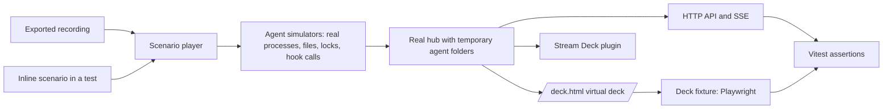

# End-to-end test harness plan

Status: Phase 1 is partly **Implemented**. Section 15.2 lists what exists and what is still **Required**. All other items in this document are **Proposed**. This plan comes from a design discussion on 2026-11-07.

## 1. Goals

1. Write behavioral tests by hand. Each test runs the real hub against mock agents of each supported type.
2. Test the fidelity of each integration. The mock agents must make the same evidence as the real agents: processes, files, locks, registrations, and hook payloads.
3. Run the full product with mock sessions only: the hub, the dashboard, the virtual deck (`/deck.html`), and the physical Stream Deck.
4. Export a real session to a recording. Any user must be able to attach the recording to an issue report. The harness must replay the recording.
5. Write a scenario inline in a test, to reproduce one specific case without a recording.
6. Examine what the virtual deck shows to the user with typed assertions.

## 2. Integration surface

Most agents do not call the hub API. The hub reads local evidence. The mock agents must make this evidence.

| Agent          | Evidence that the hub reads                                                                                                                                                       | Adapter                             |
| -------------- | --------------------------------------------------------------------------------------------------------------------------------------------------------------------------------- | ----------------------------------- |
| Codex          | A process with the name `codex` holds `thread-writer-locks/<uuid>.lock` open. `sessions/**/rollout-*.jsonl` has the events.                                                       | `src/server/codex.ts`               |
| Copilot        | A process with the name `copilot` holds `session-state/<id>/inuse.<pid>.hold` open. `events.jsonl` has the events.                                                                | `src/server/copilot.ts`             |
| Claude Code    | `sessions/<pid>.json` has the registration (pid, `procStart`, `status`, `model`). A live `claude` process must agree with it. The transcript tail gives the model and the tokens. | `src/server/claude.ts`              |
| Junie          | `index.jsonl`, `<session>/events.jsonl`, and the IDE `instances/` registrations. On macOS, the host process path must agree with `IntelliJ IDEA*.app/Contents/MacOS/idea`.        | `src/server/junie.ts`               |
| Hook reporters | JSON on stdin to `cli.ts hook <harness> <event>`. The CLI sends `PUT /api/sessions/:id`.                                                                                          | `src/cli.ts`, `src/shared/hooks.ts` |
| Claude desktop | macOS Accessibility, through `osascript`.                                                                                                                                         | `src/server/claude-desktop.ts`      |
| Host lifetimes | Open terminal descriptors and JetBrains project registrations.                                                                                                                    | `src/server/lifetimes.ts`           |

The existing unit tests give these inputs to each parser directly. The harness tests the full chain: process list, open-file ownership (`lsof` or `/proc`), file read, store, HTTP API, SSE, and the deck.

## 3. Architecture



One player runs all scenarios. Recordings and inline scenarios make the same list of steps. The same player works in three modes:

- **Test**: Vitest runs the scenario and examines the API, the SSE stream, and the deck.
- **Sandbox**: `npm run sandbox` plays scenarios in real time for the virtual deck and the physical deck.
- **Replay**: the player plays an exported recording from an issue report.

## 4. Hub under test

Start the real hub as a child process. Use `src/server/main.ts` through `tsx`, or the bundled `hub.cjs` to test the shipped bundle. Set these environment variables to folders in one temporary folder:

- `AI_AI_CAPTAIN_DATA_DIR`
- `AI_AI_CAPTAIN_CODEX_HOME`
- `AI_AI_CAPTAIN_COPILOT_HOME`
- `AI_AI_CAPTAIN_CLAUDE_HOME`
- `AI_AI_CAPTAIN_JUNIE_HOME`
- `AI_AI_CAPTAIN_JETBRAINS_INSTANCES`
- `AI_AI_CAPTAIN_PORT` (a free port in tests, `43681` in the sandbox)

The process list is global. Real agents on the computer do not show in the test hub, because their files are not in the temporary folders. Two parts do not use these folders: the Claude desktop Accessibility scan and the desktop app list. Sandbox mode turns them off (refer to section 10).

## 5. Agent simulators

Each simulator starts a real operating system process. The process name must agree with the name that the hub looks for. Use one of these methods:

- A symbolic link with the agent name to a program that is not Node.js, for example `<temp>/bin/claude` to `/bin/sh`.
- A way to set the name when the program starts, for names such as `claude bg-spare`. This is **Required**. `process.title` in Node.js is not enough on Linux (refer to the CAUTION below).
- A fake host process above the agent, for example `<temp>/IntelliJ IDEA.app/Contents/MacOS/idea` or `<temp>/Terminal.app/Contents/MacOS/Terminal`.

The harness writes the files itself. The fake host is a shell (`/bin/sh`) that starts the agent, writes the process identifier of the agent, and waits. The harness stops the agent with a signal. A scenario that must hold a file open (Codex) can use the shell: `exec 3<>file` keeps the file open.

CAUTION: Do not use a link to the Node.js program for a fake process. On Linux, Node.js renames its main thread, and `ps -o comm` shows `MainThread` for every Node.js process. The hub then never finds `claude`, `codex`, or `xterm`. On macOS the link name shows, so only a test on Linux finds this fault. The first CI run on Linux found it (2026-11-07).

NOTE: A link to `/bin/sleep` is not safe: a multi-call program can stop at once when its name is unknown. The fake agent and the fake host are links to `/bin/sh`. The CI run on Linux and macOS passed with this method (2026-11-07).

CAUTION: Names such as `claude bg-spare` and `(2.1.317)` need a way to set the process name. Check each way on macOS and on Linux. On Linux, `comm` is only the base name, with a maximum of 15 characters. Thus, names with a path, such as `…/versions/2.1.317`, do not show there. Use `skipIf` for these names on Linux.

The hub gets the host application from the parent chain of the agent process. A fake host process with a `.app` path makes the hub activate the real application when a test presses a key. Use the focus dry-run (refer to section 9) in each scenario that has a fake host process.

The agent steps write fragments from recorded fixtures of a named agent version. Thus, the tests do not contain hand-written vendor JSON.

## 6. Recording format

A recording is one JSON file with three parts:

- **Header**: format version, hub version, operating system, agent, agent version, capture time.
- **Timeline**: steps with a time offset. Each step has one operation: `spawn`, `exit`, `write`, `append`, `holdOpen`, `release`, `hook`, or `desktopSnapshot`. Paths use placeholders such as `{CODEX_HOME}`, `{CLAUDE_HOME}`, `{PROJECT_1}`, `{PID}`, `{SESSION}`, and `{T}`.
- **Expected**: the session states that the hub showed, with time offsets.

An adapter can overwrite a snapshot file in place. The Claude Code registration `sessions/<pid>.json` is an example. A file export then has only the last content, and not the changes. The hub must keep an evidence change buffer for these files (refer to section 9). Each change becomes a `write` step in the timeline.

The expected part makes a bug report into a regression test. Replay the recording, correct the expected value, and keep the file as a fixture.

## 7. Inline scenario API

Use a fluent builder. The builder makes the same steps as a recording. Thus, an inline scenario can also run in the sandbox, and `.toRecording()` can save it.

There are three levels of steps:

1. **Agent steps**, for example `startTurn()`, `status("busy")`, `requestPermission()`, `completeTurn()`, and `exit()`.
2. **Overrides** of fields in an agent step, for example `startTurn({ model: "gpt-x" })`.
3. **Raw steps** for edge cases: `appendRaw`, `writeRaw`, `truncate`, `replaceFile`, `releaseLock`, and `kill("SIGKILL")`.

Each agent factory has its own typed steps:

- `codex()`: `spawn`, `turnContext`, `startTurn`, `tokenCount`, `requestPermission`, `approve`, `completeTurn`, `releaseLock`, `exit`. The step `toolCall` is **Required**. Use `agent.as(CodexSteps)` to get the typed steps. The shape file `e2e/fixtures/codex/0.162.1/rollout-events.shape.json` limits the event keys.
- `claudeCode()`: `status`, `assistantMessage`, `registration.writeRaw`, `transcript.appendRaw`.
- `copilot()` and `junie()`: steps from their recorded event types.
- `hook("<harness>")`: `event(name, payload)`.

Builder rules:

- `.step()` runs its actions in sequence. The next line starts when they are complete.
- `expectSession` and `expectDeck` poll until the value agrees or the time limit is reached. They validate each response with the shared `zod` schemas (`sessionSchema`, `hubEventSchema`).
- The default time limit of an expectation is 15 seconds. The hub scans every 5 seconds, so a removal or a state change can take more than 5 seconds. A shorter default causes unstable tests.
- `{ within: "30s" }` sets a longer time limit. `{ during: "5s" }` makes sure that the value does not change for that time.
- `.wait()` and `.at()` exist for time-dependent behavior only. Do not use them in place of an expectation.
- `.parallel()` runs the steps of more than one agent at the same time.
- `scenario.fromRecording(file).until("t=12s")` replays a recording and then continues with inline steps.
- `.requires("darwin")` or `.requires({ openFiles: true })` skips a scenario on platforms without the necessary evidence.
- When an expectation fails, the error shows the scenario name, the step number, the last API session, and the last deck view. The harness also writes a `.recording.json` of the steps until the failure.

Example for Claude Code in a terminal:

```ts
await scenario("claude cli turn with permission")
  .deck({ viewport: { width: 900, height: 300 }, clock: "manual" })
  .agent("cli", claudeCode({ project: "/projects/shop" }))

  .step("cli", (agent) => agent.spawn({ status: "starting" }))
  .expectSession("cli", { source: "claude-local", harness: "claude-cli", state: "starting" })

  .step("cli", (agent) => agent.status("busy"))
  .step("cli", (agent) => agent.assistantMessage({ model: "claude-x", inputTokens: 2_000, cacheReadTokens: 10_400 }))
  .expectSession("cli", { state: "working", model: "claude-x", tokensUsed: 12_400, contextUsedPercent: 6 })

  .step("cli", (agent) => agent.status("permission_required"))
  .expectSession("cli", { state: "waiting" })
  .expectDeck((deck) => expect(deck.key(1).state).toBe("waiting"))

  .step("cli", (agent) => agent.status("idle"))
  .expectDeck((deck) => expect(deck.key(1)).toMatchObject({ state: "DONE", attention: "bright" }))
  .advanceDeckClock("11m")
  .expectDeck((deck) => expect(deck.key(1).attention).toBe("aged"))

  .pressKey(1)
  .expectFocus({ appName: "Terminal" })
  .expectDeck((deck) => expect(deck.key(1).attention).toBe("aged"))

  .step("cli", (agent) => agent.registration.writeRaw('{"pid":{PID},"sessionId":"{SESSION}"'))
  .expectSession("cli", {
    state: "unknown",
    metadata: expect.objectContaining({ telemetryError: "REGISTRATION_UNREADABLE" }),
  })

  .step("cli", (agent) => agent.exit())
  .expectSession("cli", undefined, { within: "15s" })
  .run();
```

The virtual deck does not mark a DONE session as attended when the user presses a key. It calls the focus endpoint only (`web-src/deck.ts`). The Stream Deck plugin calls `/api/sessions/:id/attend` first (`streamdeck/src/plugin.ts`). Thus, the key press in the example does not change the attention phase. A test of the `assessed` phase must call `POST /api/sessions/:id/attend` or use the plugin.

Behavior of the Claude Code adapter that the scenario must agree with:

- The state comes only from `status` in the registration: `busy` is working, `needs_input` and `permission_required` are waiting, `idle` is done, and `starting` is starting. A registration with no `status` gives `unknown`. Thus, `spawn()` writes the `status` of the recorded fixture.
- The registration model has priority. The transcript model applies only when the registration has no model.
- Tokens are the sum of input, cache-creation, and cache-read tokens of the last assistant line. The context percent uses a 200,000-token window.
- The adapter does not set freedom or approval.
- When the process stops, the next scan removes the session. The 10-second grace period applies only to sessions that end through the API.
- The host lifetime gate (`SessionLifetimeGate`) hides a session whose host is `closed`. A simulator without a terminal connection gets the lifetime `unverified`, and the session shows. The `open` lifetime needs a real terminal connection (`node-pty`) or a JetBrains project registration. A scenario that examines `hostLifetime: "open"` needs one of these.

## 8. Deck fixture

The fixture opens `/deck.html` of the test hub in headless Chromium. It reads each key into a typed model.

```ts
interface DeckView {
  status: string;
  page?: { current: number; total: number };
  layout: { columns: number; rows: number; singleRow: boolean };
  keys: DeckKey[];
}
interface DeckKey {
  position: number; // The place in the grid. The first key is position 1.
  number?: number; // The number in the label. Only session keys and app keys have one.
  kind: "session" | "info" | "app" | "pager" | "empty";
  action?: string;
  argument?: string;
  label: string;
  identity?: string;
  state?: string; // The value of data-state, for example "done".
  cardLabel?: string;
  attention?: "bright" | "dim" | "aged" | "assessed";
  texts: string[];
  html: string;
}
```

The fixture reads data that the deck already renders:

- `button.deck-key` with `data-action`, `data-argument`, and `aria-label="Key N: label, type, state"`.
- Info keys with `role="img"` and `aria-label="Info for …"`.
- The `<g aria-label="identity, detail: state, detail, palette">` in each card SVG from `src/shared/card-design.ts`.
- The `<text>` elements of each card.

The markup does not show the attention phase (`bright`, `dim`, `aged`, or `assessed`). The `doneAttention` function in `src/shared/attention.ts` calculates it. The fixture needs a `data-attention` attribute on the key button (refer to section 9). Do not read the phase from colors.

Fixture functions: `deck.view()`, `deck.key(n)`, `deck.infoFor(n)`, `deck.waitFor(predicate)`, `deck.press(n)`, and `deck.toolbar(name)`. `deck.press(n)` calls the focus endpoint only. It does not mark a session as attended.

Rules:

- Use the Playwright library from Vitest. Do not add the Playwright test runner.
- Use `page.clock` to control attention timers. The hub continues to use real time.
- Set the viewport, the palette, and the `localStorage` view settings in each test.
- Normalize the markup before a file snapshot. Sort the attributes and round the coordinates.
- Optional: make PNG screenshots of each key for CI artifacts. Do not fail a test on a screenshot difference.
- Later: replace the Stream Deck SDK with a recorder of `setImage` calls. Parse the plugin SVGs with the same parser.

## 9. Required hub changes

| Change                                      | Purpose                                                                                                                                                                       |
| ------------------------------------------- | ----------------------------------------------------------------------------------------------------------------------------------------------------------------------------- |
| `AI_AI_CAPTAIN_SANDBOX=1` (**Implemented**) | Turn off the Claude desktop Accessibility scan and the desktop app list.                                                                                                      |
| Claude desktop snapshot from a file         | Give `ClaudeDesktopTracker` its `Inspector` from a JSON file that the simulator writes. The constructor already accepts an inspector.                                         |
| Focus dry-run log (**Implemented**)         | Write the `osascript`, `xdotool`, or PowerShell commands to a file. Do not run them. A fake host process must never activate a real application.                              |
| Discovery interval (**Implemented**)        | Shorten the 5-second scan (`discoveryIntervalMilliseconds` in `src/server/discovery.ts`) in tests. Without it, each removal and state change costs 5 seconds or more.         |
| Evidence change buffer                      | Keep the last contents of each snapshot file that an adapter reads, for example the Claude Code registration. The export needs them to make the timeline.                     |
| Rejection reasons                           | Keep one reason for each registration or process that an adapter rejects, for example `PROCESS_NAME_MISMATCH` or `PROC_START_MISMATCH`. Show it in the dashboard diagnostics. |
| `exportEvidence(sessionId)` in each adapter | Supply the files and process evidence for the export.                                                                                                                         |
| Hook report buffer                          | Keep the last 200 sanitized reports for each API session in memory. Do not persist them.                                                                                      |
| State change buffer                         | Keep the state changes of each session in memory, for the expected part of an export.                                                                                         |
| Stable deck attributes (**Implemented**)    | Add `data-identity`, `data-state`, and `data-attention` to each key button. The tests then do not depend on the wording of the `aria-label` texts that `design.md` controls.  |

## 10. Sandbox mode

Command: `npm run sandbox -- [--port=<number>] <scenario module or recording> [more…]`. The default port is `43681`. The `--port` option allows a test while a real hub runs. The `--loop` option plays the scenarios again and again until the user presses Control and C.

1. Make sure that no hub listens on port 43681. If a hub listens, stop with a clear message.
2. Start the hub on port 43681 with temporary agent folders and `AI_AI_CAPTAIN_SANDBOX=1`.
3. Play the scenarios in real time.
4. Show the expectations as pass or fail lines in the terminal.

Virtual deck: open `/deck.html` on the sandbox hub. No change is necessary.

Physical deck: the plugin uses an external hub if a hub answers when the plugin starts.

1. Quit the Stream Deck app.
2. Start the sandbox.
3. Start the Stream Deck app.

`npm run sandbox:deck` does these three steps on macOS (**Implemented**, `scripts/dev/sandbox-deck.ts`). The command never stops a hub by force. When the sandbox stops, the plugin starts its own hub after two failed health checks. Later, add a plugin setting or a key to select the sandbox hub.

`npm run demo:keys` stays. It sends sessions to the API only. The sandbox also runs the adapters.

## 11. Export for issue reports

Users must not need Node.js or a terminal. The hub runs in the plugin. Thus, put the export in the dashboard:

CAUTION: This export goes beyond the privacy rules in ARCH-08 as they are today. The adapters read only the tail of a file, and no code keeps hook payloads. Get approval from the user and change ARCH-08 before you implement the export.

1. Each session has the action **Export for issue report**.
2. The dashboard shows a preview of the full file and a redaction summary.
3. The user downloads the file and attaches it to the GitHub issue.

Developers can also use `npm run report -- export <id>`.

Contents of an export:

| Source                                                 | Content                                                                                                                               |
| ------------------------------------------------------ | ------------------------------------------------------------------------------------------------------------------------------------- |
| File-based agents (Codex, Copilot, Claude Code, Junie) | The full history from the files that the adapter reads, through `exportEvidence`.                                                     |
| All agents                                             | The process chain from the agent to its host application at export time, with new pid numbers. The open-file evidence of the session. |
| Hook and API sessions                                  | The report buffer. Sanitize each report when it arrives, and not at export time. Hook payloads can contain tool arguments.            |
| Claude desktop                                         | The last sanitized inspector snapshots. They contain only conversation IDs and states.                                                |
| Hub                                                    | The state change buffer as the expected part. The rejection reasons.                                                                  |

### 11.1 Sanitization rules

These rules must agree with ARCH-08 in [architecture.md](architecture.md).

- Keep all keys. Thus, a format drift stays visible.
- Replace string values with `"<redacted:LENGTH>"`. Do not replace the fields on the allowlist of each adapter: event types, states, statuses, model names, token counts, timestamps, and identifiers. A length can show the size of private text. Get approval from the user for the lengths, or replace them with a fixed text.
- Keep numbers and booleans.
- Always remove message text and tool arguments.
- Replace paths with placeholders: `{HOME}`, `{CODEX_HOME}`, `{PROJECT_1}`. Remove user names and project names.
- Identifiers keep their format but not their value. Replace each session UUID with a new UUID, and use the same new UUID in all parts of the file. The adapters validate the UUID format.
- Move timestamps to a fixed start date. Keep the intervals.
- Keep the key sequence and the compact JSON format. The Junie adapter reads raw text such as `"state":"X","agentEvent"`. Mark each record whose sanitized form does not agree with the original pattern.
- Do not read authentication files, `hooks.json`, or settings files. Read only allowlisted fields.
- Add a privacy test. Put canary secrets in fixtures. The test fails if a canary is in an export.

## 12. Fidelity and drift

The vendors do not publish specifications for the files that the hub reads. A passing test then proves only that the simulator and the adapter agree with each other. Use these layers to keep the simulators close to the real agents. No layer adds a third-party dependency.

1. **Fixtures from real sessions.** Your own exports from real sessions are the fixtures of the simulators. Keep them in a folder for each agent and version. Tag each fixture with the agent version and the capture date. The hand-written recording in section 15.1.2 is the only exception. It tests the player, and not the fidelity of a simulator.
2. **Shape files.** From each real export, make a shape file. It has the key names, the key order, and the value types, but no values. A test in CI makes sure that the output of each simulator step agrees with the shape file of its declared version.
3. **Tolerance tests.** Add unknown keys to the simulator output, and remove optional keys. The adapter must continue to work. This covers the changes that a new agent version causes.
4. **Drift check.** When a new agent version comes out, a maintainer exports one real session. The tool compares its shape with the shape file of the earlier version. It reports keys that are new, removed, or changed in type. This step is manual, because CI has no agent credentials.
5. **External sources.** Where a vendor publishes a specification or open-source types, compare the shape files with them by hand when a new version comes out. Do not make this step a requirement.

Limits of these layers:

- They find drift only after a real export shows it.
- They test the shape of the files, and not the behavior of the agent. For example, only a real run shows when Claude Code writes `permission_required`.

Thus, the export tool, the fixture recorder, and the drift check are one tool.

Later option (**Proposed**): run the real agent against a fake model server. The agent then writes real evidence, and CI can run the drift check with no credentials. This option needs a mock server and the agent binaries in CI. Do not implement it without approval from the user. The decision for now is to add no third-party dependency for agents.

## 13. Platforms

- Linux CI: ownership comes from `/proc`. Real child processes work.
- macOS: `lsof` works with real child processes. Do the symbolic link check in section 5 first.
- Windows: the hub cannot list open files. Only lock-file ownership and Claude Code registrations can be tested. Use `skipIf` for the other scenarios. Do not fake a pass. The starter tests in section 15.1 have not run on Windows yet. Confirm them before you claim Windows support.
- Junie: the host process check uses a macOS `.app` path. Mark Junie scenarios as macOS only until this is confirmed for other systems.
- Claude desktop: macOS only.
- CI runs the scenarios in the `e2e` job on Linux and macOS (**Implemented**, `.github/workflows/ci.yml`). The job installs Chromium with `npx playwright-core install --with-deps chromium`. The browser runs headless, so no display is necessary. A failed job uploads the recordings of the failed scenarios.

## 14. Tools

The user approved two new development dependencies on 2026-11-07: Playwright (library only) and `node-pty`. Playwright is installed. Add `node-pty` as a `devDependency` with the first scenario that needs it, because its install script builds native code in every CI job. The harness uses the package `playwright-core`, which is the library without the test runner. The install script of `node-pty` needs approval in npm (`npm approve-scripts node-pty`). Neither package is allowed in the shipped hub or plugin bundles. Do not add other dependencies without approval (AGENTS.md, section 3.2).

| Decision                                                         | Reason                                                                                |
| ---------------------------------------------------------------- | ------------------------------------------------------------------------------------- |
| Vitest, with a separate `e2e` project and `vitest.e2e.config.ts` | The project already uses Vitest. `expect.poll` and file snapshots are available.      |
| `playwright-core`, called from Vitest                            | A real browser runs `/deck.html`, SSE, and the layout. One test runner is sufficient. |
| `node:child_process` for simulators                              | No new dependency is necessary.                                                       |
| No Cucumber or Gherkin                                           | A translation layer is not necessary for tests written by hand.                       |
| No Pact                                                          | The vendors do not publish contracts. Recorded fixtures do the same work.             |
| No MSW or nock                                                   | The hub does not send HTTP requests to the agents.                                    |
| `node-pty` (approved)                                            | Only for scenarios with the host lifetime `open`. It is a native dependency.          |

The `e2e/` folder must be in `tsconfig.eslint.json` and in `npm run typecheck`, so that the linter and the type check cover it. The unit tests in `e2e/harness/` run in `npm test`. The scenarios in `e2e/scenarios/` must not be in `vitest.config.ts`, so that `npm test` does not start the hub. `npm run test:e2e` uses `vitest.e2e.config.ts`.

## 15. Phases

1. Recording format, scenario player, builder API, Codex and Claude Code simulators, deck fixture, sandbox flag, `npm run sandbox`, `npm run test:e2e`, and the two starter tests in section 15.1. Also the discovery interval setting, the focus dry-run, and the stable deck attributes from section 9. Also the shape files and the tolerance tests from section 12. The first scenario is the known defect in section 16.
2. Export for file-based agents in the dashboard and the CLI. Sanitization and the privacy test.
3. Copilot and Junie simulators, the hook and desktop buffers, Windows coverage, the plugin sandbox setting, and the `setImage` recorder.

### 15.1 Starter tests

The Phase 1 setup must supply two starter tests. Both tests walk through the same simple life cycle of one Claude Code session. The tests show new contributors how to write a scenario. They also make sure that the builder and the player agree.

Life cycle of the starter tests:

| Step | Agent action                       | Expected session state |
| ---- | ---------------------------------- | ---------------------- |
| 1    | Start the process and write `busy` | `working`              |
| 2    | Write `permission_required`        | `waiting`              |
| 3    | Write `busy`                       | `working`              |
| 4    | Write `idle`                       | `done`                 |
| 5    | Stop the process                   | No session             |

Rules for the starter tests:

- Use the Claude Code simulator. Its evidence is one registration file and one process, so the test stays small.
- Let the harness start the agent under its fake host program (`Terminal.app` on macOS, `xterm` on Linux). Without it, the hub finds the real terminal or editor that runs the test, and the harness (`claude-cli` or `claude-ide`) depends on the computer. The hub sets `harness: "claude-cli"` with the fake host.
- Do not assert `hostLifetime`. The lifetime depends on the terminal connection of the real parent processes (`open` in a terminal, `unverified` in CI).
- Do not use `.requires()`. The registration check works on macOS, Linux, and Windows (refer to section 13).
- Do not use `.wait()` or `.at()`. Use expectations only.
- Set the time limit of each expectation to more than one discovery interval. Use the discovery interval setting in section 9 to make the tests fast.
- Put both tests in `e2e/scenarios/claude-code-lifecycle.e2e.test.ts`. The inline scenario is in `e2e/scenarios/claude-code-lifecycle.ts`, so that the sandbox plays it too.

#### 15.1.1 Inline scenario

```ts
test("claude code life cycle from an inline scenario", async () => {
  await scenario("claude code life cycle")
    .deck({ viewport: { width: 900, height: 300 }, clock: "manual" })
    .agent("cli", claudeCode({}))

    .step("cli", (agent) => agent.spawn({ status: "busy" }))
    .expectSession("cli", { source: "claude-local", harness: "claude-cli", state: "working" })

    .step("cli", (agent) => agent.status("permission_required"))
    .expectSession("cli", { state: "waiting" })

    .step("cli", (agent) => agent.status("busy"))
    .expectSession("cli", { state: "working" })

    .step("cli", (agent) => agent.status("idle"))
    .expectSession("cli", { state: "done" })
    .expectDeck((deck) => expect(deck.key(1).state).toBe("done"))

    .step("cli", (agent) => agent.exit())
    .expectSession("cli", undefined)
    .run();
});
```

The inline test also examines the deck one time. Thus, it tests the full chain from the files to `/deck.html`.

#### 15.1.2 Recording

The recording is a hand-written file: `e2e/fixtures/claude-code/hand-written/lifecycle.recording.json`. It does not come from an export. Thus, it contains no user data. It tests the player and the placeholders. It does not prove that a simulator agrees with a real agent (refer to section 12).

```json
{
  "header": {
    "formatVersion": 1,
    "source": "hand-written",
    "agent": "claude-code",
    "agentVersion": "2.x",
    "platform": "any"
  },
  "timeline": [
    { "offset": "0s", "operation": "spawn", "agent": "cli", "processName": "claude" },
    {
      "offset": "0s",
      "operation": "write",
      "path": "{CLAUDE_HOME}/sessions/{PID}.json",
      "content": {
        "pid": "{PID}",
        "sessionId": "{SESSION}",
        "cwd": "{PROJECT_1}",
        "startedAt": "{T}",
        "status": "busy"
      }
    },
    {
      "offset": "2s",
      "operation": "write",
      "path": "{CLAUDE_HOME}/sessions/{PID}.json",
      "content": {
        "pid": "{PID}",
        "sessionId": "{SESSION}",
        "cwd": "{PROJECT_1}",
        "startedAt": "{T}",
        "status": "permission_required"
      }
    },
    {
      "offset": "4s",
      "operation": "write",
      "path": "{CLAUDE_HOME}/sessions/{PID}.json",
      "content": {
        "pid": "{PID}",
        "sessionId": "{SESSION}",
        "cwd": "{PROJECT_1}",
        "startedAt": "{T}",
        "status": "busy"
      }
    },
    {
      "offset": "6s",
      "operation": "write",
      "path": "{CLAUDE_HOME}/sessions/{PID}.json",
      "content": {
        "pid": "{PID}",
        "sessionId": "{SESSION}",
        "cwd": "{PROJECT_1}",
        "startedAt": "{T}",
        "status": "idle"
      }
    },
    { "offset": "8s", "operation": "exit", "agent": "cli" }
  ],
  "expected": [
    { "offset": "0s", "session": "claude:{SESSION}", "state": "working" },
    { "offset": "2s", "session": "claude:{SESSION}", "state": "waiting" },
    { "offset": "4s", "session": "claude:{SESSION}", "state": "working" },
    { "offset": "6s", "session": "claude:{SESSION}", "state": "done" },
    { "offset": "8s", "session": "claude:{SESSION}", "state": null }
  ]
}
```

Placeholder rules that this recording uses:

- A string that is only `{PID}` or `{T}` becomes a number. `{T}` is the time in epoch milliseconds when the harness started the agent process. The registration check needs `startedAt` to be later than the process start.
- `{SESSION}` becomes a new lowercase UUID for each playback.
- `{PROJECT_1}` becomes an absolute folder in the temporary folder.
- `"state": null` in the expected part means that the session must not exist.

```ts
test("claude code life cycle from a recording", async () => {
  await scenario.fromRecording("e2e/fixtures/claude-code/hand-written/lifecycle.recording.json").run();
});
```

The player examines each item of the expected part in sequence. Each item uses the time limit of an expectation, not the exact offset. Thus, a slow scan does not make the test fail.

#### 15.1.3 Acceptance criteria

- `npm run test:e2e` runs both tests, and both tests pass on macOS and Linux.
- The two tests give the same sequence of session states.
- `.toRecording()` of the inline scenario gives the same operations and expected states as the recording file. Only the offsets can be different. A third test in the same file makes sure of this.
- When you change one expected state in the recording to an incorrect value, the test fails. The error shows the scenario name, the step number, and the last API session.

### 15.2 Status of Phase 1

| Item                                                                    | Status          | Where                                                                        |
| ----------------------------------------------------------------------- | --------------- | ---------------------------------------------------------------------------- |
| Recording format and placeholder rules                                  | **Implemented** | `e2e/harness/recording.ts`, `placeholders.ts`                                |
| Scenario player and builder API (spawn, write, exit, expectations)      | **Implemented** | `e2e/harness/scenario.ts`, `scenario-player.ts`, `scenario-items.ts`         |
| Claude Code simulator (macOS and Linux)                                 | **Implemented** | `e2e/harness/claude-code.ts`, `agent-process.ts`                             |
| Hub launcher with temporary folders                                     | **Implemented** | `e2e/harness/hub-process.ts`, `scenario-environment.ts`                      |
| Deck fixture with `bright`, `dim`, `aged`, and `assessed` attention     | **Implemented** | `e2e/harness/deck-fixture.ts`, `web-src/deck.ts`                             |
| Sandbox flag, discovery interval, focus dry-run, stable deck attributes | **Implemented** | `src/server/sandbox.ts`, `discovery.ts`, `focus.ts`, `web-src/deck.ts`       |
| `npm run test:e2e`, `npm run sandbox`                                   | **Implemented** | `vitest.e2e.config.ts`, `scripts/dev/sandbox.ts`                             |
| Two starter tests and the equality test                                 | **Implemented** | `e2e/scenarios/claude-code-lifecycle.e2e.test.ts`                            |
| Shape file, shape check, and tolerance scenarios (Claude Code)          | **Implemented** | `e2e/harness/shape.ts`, `e2e/scenarios/claude-code-registration.e2e.test.ts` |
| Codex simulator (lock file held open, rollout events)                   | **Implemented** | `e2e/harness/codex.ts`, `e2e/scenarios/codex-lifecycle.e2e.test.ts`          |
| Transcript steps of Claude Code (`assistantMessage`)                    | **Required**    |                                                                              |
| Scenario for the known defect in section 16                             | **Required**    | Needs a decision on the open questions in section 17                         |
| `.parallel()`, `.at()`, `.requires()`, `skipIf` helpers                 | **Required**    |                                                                              |
| Windows support of the simulators                                       | **Required**    | `isAgentSimulationSupported` is false on Windows                             |

## 16. Known defect to reproduce first

The Claude Code adapter does not show Claude sessions that JetBrains Air starts in IntelliJ IDEA 2026.3. Evidence from `ps -axo pid=,ppid=,comm=` on macOS on 2026-11-07:

| Registration   | Process name in `ps`                                 | Parent                                 | Accepted |
| -------------- | ---------------------------------------------------- | -------------------------------------- | -------- |
| Air sessions   | `(2.1.317)`                                          | IntelliJ IDEA                          | No       |
| Native install | `/Users/<user>/.local/share/claude/versions/2.1.319` | `ClaudeCode.app/Contents/MacOS/claude` | No       |
| Spare process  | `claude bg-spare`                                    | `claude bg-pty-host`                   | No       |
| Terminal CLI   | `claude`                                             | Terminal                               | Yes      |

Cause: `claude.ts` accepts only names that agree with `/(?:^|\/)claude$/` (in `ownsRegistration` and in `scan`). `lifetimes.ts` uses a combined pattern for all agents: `/(?:^|\/)(?:copilot|copilot-runtime|codex|claude)$/`. The new function must replace only the `claude` part of that pattern.

Proposed correction:

1. Add `isClaudeCodeProcess(name)` to `processes.ts`. Use it in `claude.ts` and `lifetimes.ts`.
2. Accept `…/claude`, `…/claude/versions/<semver>`, and `(<semver>)`. The registration check of pid and start time prevents false matches.
3. Do not show `claude bg-spare` and `claude bg-pty-host` as sessions until a turn starts. Confirm this behavior first.
4. Add unit tests for `parseProcesses` with these names. Add harness scenarios with `processName: "versions/2.1.317"` and `processName: "claude bg-spare"`.

## 17. Open questions

- Should a key press on the virtual deck mark a DONE session as attended, as the Stream Deck plugin does? Today it does not. Decide before the scenarios examine the `assessed` phase.
- What do `claude bg-spare` and `claude bg-pty-host` do? Should the hub show them?
- Which GitHub attachment type to use for an export: `.json`, or `.json` in a `.zip`?

### 17.1 Specification work before implementation

- Give this plan requirement IDs. ARCH-09 now refers to this plan. The plan has no IDs of its own yet.
- Done: the plan is in the document table of AGENTS.md. The harness folders are in ARCH-03 and in the `project-structure` skill.
- Change ARCH-08 for the export (refer to section 11) and get approval from the user.
- Get approval from the user for each new dependency other than Playwright and `node-pty` (refer to section 14).
- Make sure that `node-pty` installs on all CI systems. It is a native dependency. If it fails on one system, use `skipIf` for the scenarios that need it.

## 18. Related documents

- [architecture.md](architecture.md): ARCH-03 component map, ARCH-08 privacy rules, ARCH-09 verification rules.
- [functionality.md](functionality.md): lifecycle states and acceptance scenarios.
- [intagration.md](intagration.md): supported tools and the hook CLI.
- [design.md](design.md): key states and attention.
